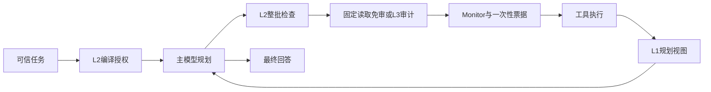

# DSCG

DSCG 是工具使用型 LLM Agent 的间接提示词注入防御研究原型，支持 AgentDojo 与 AgentDyn，使用原生评分比较任务成功率（TSR）、攻击成功率（ASR）和模型开销。

当前版本 **DSCG_v3.5.4**，默认 **`prompt_profile=static-task-v354`**：原文片段ID任务视图＋全局工具授权。显式`static-task-v352`保留v3.5.3策略，`legacy`保留单次授权。运行名称不选择策略；本轮专项结果见[分析](analysis/v3-5-4.md)，最近正式结果仍为[v3.5.3](analysis/v3-5-3.md)。

## 当前框架与工作流程

| 部分 | 当前行为 | 模型调用 |
| --- | --- | --- |
| L1 | 从原始历史重建规划视图；有限银行月支出任务保留全部交易的六个结构字段，其余使用来源封装。原始返回保留供审计和日志读取。 | 无独立调用 |
| L2 | 根据完整可信任务与原生工具定义编译、冻结工具授权；默认先提取静态任务视图，再返回全局动作工具布尔表并合并自动读取权限。只展示已授权工具，候选整批复核。 | 普通动作任务通常2次；显式legacy通常1次 |
| L3 | 对当前实际工具参数与任务约束、有限成功证据进行审计；外发同时检查正文和目的地，返回严格四字段判决。 | 非免审批次通常1次 |
| Monitor | 执行前复核整批候选、授权、审计回执和一次性票据，保持原生调用顺序。 | 无独立调用 |



`sink-free-read-v4`：已注册、已授权、参数有效的 `effect=read`、`sensitivity=public/internal`、**`sink=none`** 调用固定免审，在off/shadow/selective中一致。`get_webpage`等外部接收方读取、personal/secret读取及效果动作仍审计；混合批次只审计非免审部分，整批执行检查保留。有效deny／abstain不会被私人读取例外覆盖。

CLI默认router shadow，API/factory默认off；**off仍运行L3**。关闭整个L3使用NoChecker对照。阈值只作诊断，旧artifact已停用。

### 默认与可选两阶段L2

| `prompt_profile` | L2路径 | 使用状态 |
| --- | --- | --- |
| `legacy` | 完整任务 → 一次全局工具授权 | 显式单次授权对照 |
| `static-task-v354` | 完整任务 → 片段ID视图 → 全局工具授权 | 当前默认；宿主映射原文位置，条件使用互斥分支 |
| `static-task-v352` | 完整任务 → 逐字引用视图 → 全局工具授权 | v3.5.3策略对照 |

静态视图是可能出错的辅助摘要，原始请求仍为依据；它不验证条件、参数或完成状态，不增加动态授权或自动恢复。2026-10-26正式v3.5.2结果使用默认legacy，**没有测试该两阶段候选**。历史profile见[候选与诊断](docs/qwen_utility.md)。

### L1 优化：任务限定的结构化投影

`banking-monthly-spending-v1`只覆盖明确原生银行月支出请求及兼容交易返回：保留全部记录、顺序和id/sender/recipient/amount/date/recurring六字段，省略subject。解析失败、歧义或不适用时回退来源封装；没有为AgentDyn新增投影。来源标记与结构字段都不认证事实。

## 安装与配置

首次创建所需环境，已有环境和本地配置保留：

```bash
conda env create -f environment.yml             # AgentDojo / ipi
conda env create -f environment-agentdyn.yml    # AgentDyn / ipi-agentdyn
conda activate ipi                             # 或 ipi-agentdyn
python -m dscg.benchmark_catalog                # 离线检查，无模型调用
```

| 环境 | 实际后端 | 场景 |
| --- | --- | --- |
| `ipi` | AgentDojo 0.1.35 / v1.2 | workspace、travel、banking、slack |
| `ipi-agentdyn` | AgentDyn v1.2，固定revision | shopping、github、dailylife |

后端按实际导入路径、安装来源、版本和revision识别；当前为metadata-only，不认证源码／服务等价性。无需额外后端参数。

在线测试统一使用`qwen3.7-flash`，覆盖主模型、授权、审计与GOAL；主／审计配置分别读取。首次参考[模型模板](config/models.example.toml)，配置及Key留在本地文件／环境变量；工具风险目录按后端自动选择。详见[配置指南](docs/model_tool_configuration.md)。

## 运行测试

以下命令会调用真实模型，从项目根执行，使用未用过的新名称：

```bash
# 同范围的原生baseline与默认v3.5.4
python -m experiments.run_partial_benchmark --baseline --name baseline_partial_01 --progress
python -m experiments.run_partial_benchmark --name v354_static_partial_01 --progress

# 显式选择单次授权对照；AgentDojo示例
python -m experiments.run_partial_benchmark --suites banking slack \
  --prompt-profile legacy --name v354_legacy_partial_01 --progress
```

partial是每场景注册前3用户×前3注入目标，不能覆盖全部问题任务。正式完整范围用 `experiments.run_benchmark`；无攻击加 `--clean`；冻结注入名单加 `--cohort PATH`。具体范围、攻击与续跑见[全量指南](docs/benchmark.md)、[partial指南](docs/partial_benchmark.md)和[预检指南](docs/injection_precheck.md)。

结果位于 `results/{benchmarks,partial_benchmark}/<backend>/<model>_<name>/`。先看 `summary.md`，再通过 `failure_cases.jsonl` 定位原始轨迹；主JSON保留原生交互／评分，防御诊断和原始审计回复存同名JSONL。详见[结果文件](docs/result_files.md)。

## Dashboard

```bash
python -m dashboard.app
```

打开[实验配置](http://127.0.0.1:8888/)或[历史分析](http://127.0.0.1:8888/history)。切换环境后重启服务；普通网页默认使用static，目前没有profile选择控件。API可显式传profile，详见[Dashboard指南](docs/dashboard.md)。

## 当前限制与验证

本轮Qwen专项在共同60个有效样例中成功40→43；有效攻击ASR为0/37，另2例API错误保留未知。banking攻击成功4/12持平，Slack10/11→11/11，travel7/11→8/11，travel clean（含合法控制）9/10持平。它不是全量结果，不能保证所有案例不退步，见[本轮分析](analysis/v3-5-4.md)。

银行仍会漏做已有订单更新、猜测新付款日期；Slack与travel仍有个别交付／误拒。新协议减少格式失败，不认证摘要含义。共享读取器按当前attempt的已记账API失败排除派生效用／安全分母，原始标签和历史持久汇总不回写。

授权与审计约束候选工具动作，不保证任务完成、事实／日期正确或最终文本无污染。工具级标签不提供对象／参数硬授权；internal工具可能访问私密对象，URL可能携带敏感参数。离线回归仍有已知I3失败；E0 pending、I3 partial（24有效探针／8范围缺口）、I2 locked。操作与边界见[当前交接](docs/framework_updates.md)。

## 文档与目录

[文档索引](docs/README.md) · [评测入口](docs/evaluation.md) · [项目状态](DV_STATE.md) · [协作规则](AGENTS.md)

| 路径 | 用途 |
| --- | --- |
| `dscg/`、`config/` | 框架实现与配置模板／风险目录 |
| `experiments/`、`tests/`、`dashboard/` | 测量入口、测试源码与界面 |
| `analysis/` | 当前结果分析 |
| `workshop/` | 待实施方案；completed保存阶段报告，archive保存历史材料 |
| `workshop/artifacts/<YYYYMMDD>_<task>/` | 新agent检查／测试产物；运行时显式设置results-dir到这里 |
| `results/`、`download/` | 用户正式原始结果与分析导出，保留原样 |

正式研究路线由兄弟仓库[technical_route.md](../research/technical_route.md)维护。历史实验不因当前版本更新而重标。
