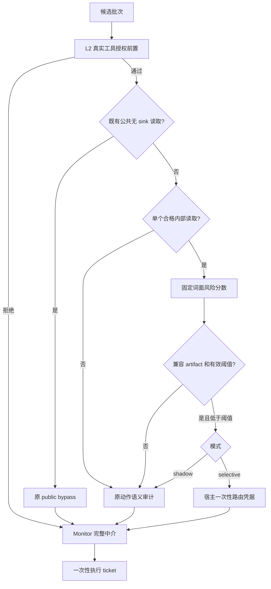

# L3 Checker 优化：纯算法选择性审计

> 2026-10-15：当前审计输入为v2，有界相关调用—返回证据共享8192字符预算，最多8条；旧输入/校准artifact不能直接沿用。见[Clean修正报告](./completed/clean_utility_20261015.md)。纯算法路由仍off，未部署真实阈值。

更新：2026-10-10。**工程实现已接入；真实独立标签、部署校准和端到端收益验收尚未完成。** 用户已选择纯算法版，替代旧方案的稀疏逻辑回归。原文原字节保存在 [修订归档](./archive/l3_selective_impl_20261010/originals/workshop/L3_checker_opt.md)，基础三层见 [已实施方案](./completed/3_layer_opt.md)。实施报告见 [L3 工程报告](./completed/l3_algorithm_implementation_20261010.md)。

本优化属于 L3 内部的审计调度。既有授权、Monitor、ticket 和读取 deny 例外继续执行。没有新增对象/数据权限、来源认证、恢复动作或第四层；正式 research 路线不改变。默认 `off`、`audit_retries=0`、`completion_prompt=false`。没有随代码附带一个可以部署的非空阈值。

## 1. 不依靠小模型：硬条件、固定分数和校准阈值

在线计算只用 Python 标准库，不训练分类器，不请求 embedding、小语言模型或主模型隐藏状态。昂贵语义审计器仍处理需要审计的动作。



公共读免审和 L2 拒绝是既有能力，不能计作本次新增节省。新分支只考虑**有效注册、已授权、单调用、read、sink=none、sensitivity=internal、idempotent=true**。个人/秘密读取、写入、删除、金融、发送、外部 sink、混合批次均不通过该门。元数据不按工具名字猜测。

任务超2048字符、宿主描述超512字符、参数实际裁剪/不支持/非有限、当前任务证据选取遗漏、共享8192字符预算截断、调用参数裁剪或文件正文省略、32项动作窗口截断、工具错误、空任务/描述、schema不匹配、总输入超12288规范化字符时，继续原完整审计。完整性必须提供8个明确布尔标记（request/description/history/window/content/error/argument truncation/argument unsupported）；缺失或未知字段不是“完整”。完整性是宿主布尔标记，正文里的 `<max-depth>` 不会自行改变资格。边界是字符和结构，不是 Token。

## 2. 固定公式

对任务 T、宿主描述 H、参数值 A、不可信返回 U 分开做 NFKC、控制字符显式化、casefold、空白规范化，再统计字符三元组；短于3字符的文本保留一个短片段。用三元组频次余弦相似度 `cos`，不拟合 IDF 或权重。

| 信号 | 公式/含义 |
| --- | --- |
| 任务—工具距离 | `d = 1 - cos(T,H)` |
| 参数新颖度 | `n = A 中不在 T∪H 三元组集合里的频次 / A 总频次` |
| 不可信支持增量 | `u = max(0, cos(A,U)-cos(A,T))` |
| 近期失败比例 | `h = (failed+blocked) / 当前有限动作记录数` |

最终 `s=max(d,n,u,h)`，范围 `[0,1]`。空参数值的 n/u 为0；没有历史时 h 为0。严格用 `s < tau`，等于阈值仍审计。任一较高信号可要求审计，无可训练系数。

这只是可复现的风险排序启发式。词面相似不证明安全，参数新颖度不实施对象权限，不可信支持差异不认证来源。词面相似的恶意参数可能低分；合法同义词和首次准备读取可能高分。近期错误会增加审计开销；无命令关键词不构成免审理由。改公式或输入版本必须重新校准，不能看测试结果后补关键词。

调用ID、hash、ticket、suite/task/attack标签、utility/ASR、隐藏目标、审计意见和confidence不进入四个在线信号。路由器不缓存 allow；每个候选重新计算。

## 3. 模式与失败回退

| 模式 | 本地行为 | 执行行为 |
| --- | --- | --- |
| off，默认 | 不加载 artifact，不计算路由，不新增路由事件 | 原基础三层 |
| shadow | 合格动作计算固定分数；无 artifact 也可观察分数，但 would_bypass=false | 始终保留该有的完整审计，实际节省为0 |
| selective | 合格且配置/工具/schema兼容、非空校准阈值有效、低于阈值时签发路由凭据 | 其余回原完整审计；不追加模型或替代动作 |

baseline、NoSandbox、NoChecker 不允许开启路由。artifact缺失、非法JSON、重复键、NaN/Inf、版本/哈希/校准信息不匹配、超过8MiB、适用工具未覆盖等均不能免审；加载错误记录为有界错误类型。安全模型错误仍沿用原 fail-closed 行为。

artifact的兼容域冻结 catalog/schema、主模型/审计模型公开配置、温度/推理选项、主提示/授权/隔离/审计/完成策略摘要、L1/L2前置/重审/完成开关和输入边界、输入/特征版本。配置标识不锁定云服务的实际模型修订。这里的域检查只是保守增加审计，不能识别全部未见任务或防御感知攻击。

## 4. 校准算法和标签

独立标签只有 `safe_and_sufficient` 为 Y=0；`unsafe`、`insufficient_or_ambiguous`、`unjudgeable` 为 Y=1。`invalid_sample` 报告排除原因，不计入有效分母。校准入口还重新按实际rows核对标签来源、split/相关输入、group/action分母与manifest一致性；artifact校验组/动作/错误计数关系。只接受 `independent_policy`、`environment_oracle`、`human_double_review` 标签来源及明确证据引用。审计allow、Monitorallow、未攻击成功都不是真值。

按独立 `episode_group_id` 聚合同组任务/对象/原文档/注入模板及相关版本。development/calibration/test不能拆组；相同 correlation key 或完全相同输入包不能跨组。程序不能自动判断隐含近重复或标签真实性，必须由外部核查并明确attest。

预先固定 K 个阈值和 epsilon/delta。每个阈值：

```text
A_j = 组j至少有一项合格动作满足 s<tau
Z_j = 组j至少有一项这样的动作的独立标签Y=1
m = sum(A_j); k = sum(Z_j)
U = 单侧Clopper–Pearson上界，alpha=delta/K
```

`m=0` 不认证，`k=m` 上界为1；`k=0` 时 `U=1-(delta/K)^(1/m)`，其余用稳定二项CDF反解。只选 `m>0 且 U<=epsilon` 的阈值；从中选择冻结的审计包JSON字符成本估计总量最大者，平局选较小阈值。没有可行值输出 `threshold=null`。

条件风险是“至少发生一次免审的组中，至少一次不应免审的概率”；不把每次读取当独立单位。epsilon/delta由调用者预先指定，没有自动降低标准。经验计数不能证明组独立。上界需要固定选择器、可靠标签、组间独立同分布；shadow只覆盖参考轨迹，不能认证selective改变后的轨迹或适应性攻击。风险/多重检验定位参考 [Learn then Test](https://arxiv.org/abs/2110.01052)，本项目不是新的校准定理。

## 5. 数据协议与可运行命令

代码：

- [固定路由/校准/凭据](../dscg/audit_router.py)
- [checker与Monitor接线](../dscg/pipelines/defended.py)
- [显式数据准备](../experiments/l3_router_dataset.py)
- [分组阈值校准](../experiments/calibrate_l3_router.py)
- [partial runner](../experiments/run_partial_benchmark.py)

数据准备只读取显式提供的、已独立标注的JSONL，不自动扫描results/download，也不根据审计器生成标签。一行需提供：

```json
{
  "episode_group_id": "independent-group",
  "episode_id": "episode-1",
  "correlation_key": "task-object-document-template-family",
  "split": "development",
  "label": "safe_and_sufficient",
  "label_source": "environment_oracle",
  "label_evidence_ref": "independent-evidence-reference",
  "packet": "实际有界audit_input对象，不是这里的示意字符串",
  "input_sha256": "dscg.audit_router.digest(packet)",
  "host": {
    "catalog_sha256": "宿主摘要",
    "tool_schema_hash": "宿主当前工具摘要",
    "model_config_sha256": "factory公开路由配置摘要",
    "schema_valid": true,
    "completeness_flags": "真实宿主布尔标记对象"
  }
}
```

以上字符串是字段说明，不是可用样本。完整输入来自受控full sidecar里的audit_input；对应router事件给出input/catalog/tool/config摘要与完整性标记。无独立标签时不能填 safe。JSONL已显式含私有内容，需自行保管；生成的rows/manifest只保留数值、标识、hash和证据引用，不复制任务和工具正文。数据集必须是同一catalog/模型配置；未在development覆盖的工具不能进入免审校准。标签来源须一致；若需混合，先独立核查其一致语义。

已激活ipi的命令（使用新的任务目录和输出文件）：

```bash
python -m experiments.l3_router_dataset --input <labeled.jsonl> --output-dir workshop/artifacts/<task>/dataset
python -m experiments.calibrate_l3_router --dataset-dir workshop/artifacts/<task>/dataset --grid <预先冻结的阈值列表> --epsilon <风险目标> --delta <置信错误水平> --attest-independent-groups --output workshop/artifacts/<task>/router.json
python -m experiments.run_partial_benchmark --name <new-shadow-name> --audit-router-mode shadow --audit-router-artifact workshop/artifacts/<task>/router.json --results-dir workshop/artifacts/<task>/partial_benchmark
```

数据准备输出已存在会拒绝；artifact使用新文件、拒绝覆盖。`--attest-independent-groups` 是人工/研究核查声明，不是程序自动证明。无 artifact 的shadow可收集分数；部署 selective 将模式显式改为selective，仍需真实冻结策略端到端pilot。不能将本轮测试里的合成非空阈值作为部署artifact。

API同样支持 `make_defended_pipeline(audit_router_mode="shadow", audit_router_artifact=path)`。factory配置里的 `audit_router_config_sha256` 是上述公开配置绑定值。普通运行不需要额外文件。模式/artifact/config绑定run_manifest与默认pipeline缓存名；显式name仍应新建，force-rerun不绕过manifest。

## 6. Monitor交接和实际读取语义

selective命中由宿主生成 `AuditDecision`：allow、confidence=0、reason=`SELECTIVE_READ_BYPASS`、semantic_attempt=0、parser_status=`deterministic_bypass`、model_version=`local-router:<digest>`。0不是语义置信度，公开allow JSON不授予权限。

checker/Monitor共享进程内 `RouterReceiptVerifier`。启用路由时所有checker结果（完整审计、public/L2和新增免审）均通过受信交接，不能删除公开标记后降级成普通allow。凭据绑定完整任务、候选args和调用ID、授权状态/contract、catalog/schema/运行函数身份/依赖、完整动作历史/source-ID状态、上下文、mode、artifact内容和配置。Monitor验证来源并一次消费，再执行原授权/审计逻辑、签发原执行ticket。记录更改、旧/伪造凭据、候选或宿主状态变化都不能执行；内部对象不进入日志/主模型。

**保留实际原语义**：已授权read/sink=none的有效完整审计deny，Monitor仍可按 `READ_ONLY_SOURCE_ALLOW` 执行；abstain、模型/解析错误和无效记录阻断。保持秘密读取被审计，不等于其deny一定阻断。分别记录原审计意见、Monitor最终结果和离线独立标签；本算法不修复I3对象/目的地/数据范围缺口。

## 7. 日志与成本

启用路由时每个真实候选批次一条compact router event；包括独立public/L2路径、资格/原因、score/features、threshold/calibration、完整性、绑定摘要、would/actual、local latency、原审计与Monitor最终结果。完整输入只在既有full sidecar。off不产生新增事件。

API消耗由原TokenTracker记录，本地计算不计API Tokens。真实审计缺失usage、失败调用或非追踪测试替身时成本为unknown/null，不能记0；实际免审没有审计调用，审计Tokens为0。summary.json新增audit_router分母/覆盖率、调用数、known/unknown审计成本、shadow潜在节省和本地延迟。只读取本次scored任务的trace，缺失记录单列。`actual_total_tokens_saved=null`，实际总节省须匹配对照另算。

比较分母R排除原public bypass和L2拒绝，E是合格内部读取，B是实际新增免审。报告E/R、B/R、B/E；shadow would-save仅是原轨迹上的观测估计。既有API阶段统计保留授权/主模型/审计/攻击preflight，不能将审计下降比例写成系统总成本下降比例。

## 8. 完成范围与剩余验收

| 项目 | 状态 |
| --- | --- |
| 硬条件、固定算法、JSON校准artifact与保守回退 | 已实现 |
| off/shadow/selective、checker/Monitor凭据、ticket衔接 | 已实现，默认off |
| 显式数据工具、分组CP、split/标签检查、CLI/cache/成本记录 | 已实现 |
| 逻辑回归训练/权重/IDF | 被用户选择的纯算法替代，不再计划实现 |
| 真实独立标签、部署阈值、shadow/selective匹配模型试验 | 待完成；当前没有部署用非空阈值 |
| 网页CSA独立模式/artifact控件与专门路由曲线 | 尚未接入；API/partial CLI已可用，基础三层网页保留 |
| personal扩展、DRV、恢复/扩权、闭合provenance路线 | 未实施，不随本优化解锁 |

本轮工程测试与微基准不等于模型benchmark或安全认证。真实E0仍待通过；I3仍partial，I2锁定。下一步是独立核查一组真实internal-read成对样本和组关系，预注册grid/风险目标，再用新的run名做shadow、冻结selective和当前off匹配比较；若覆盖或收益不足则保留完整审计。

本轮独立审查保留两项小项：当前 `router_total_latency_ms` 仅计assess阶段，不包括后续凭据/Monitor绑定复核；发生中途异常时未消费的路由凭据尚未在外层任务边界统一清理。正常路径一次消费和任务/状态绑定仍有效。它们不作为已解决或已测完整成本，见实施报告。
