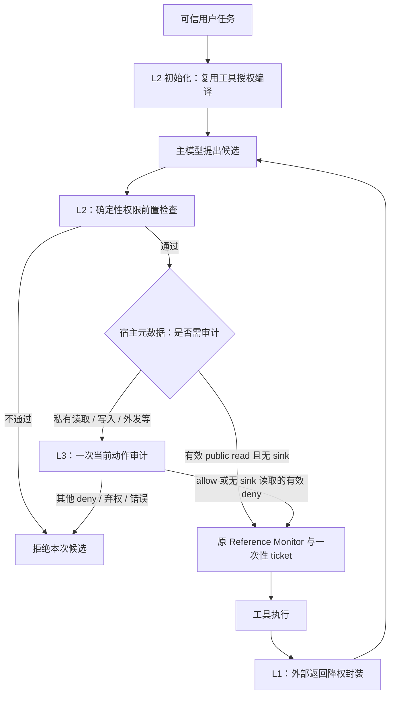

# DSCG 低开销三层候选：输入降权、任务授权、按风险动作审计

方案日期：2026-10-09；工程更新：2026-10-10。状态：**基础三层已按用户明确要求实施，真实模型消融与收益验证待完成**。目标是 [AIMLL Workshop CFP](<./archive/legacy_submission/AIMLL WS.pdf>) 所描述的实际防御与经验评估。本轮允许调整层次排列，把贡献定位为有实证支撑的系统设计；不再以新的反事实算法为目标。

**主推荐：新增零模型调用的工具返回隔离层，将现有任务授权列为 L2，现有动作安全审计列为 L3。取消在线 DRV 的三个影子提议。** 每个通过权限检查、确实需要语义审计的候选批次至多一次安全模型调用。来源隔离与确定性检查增加宿主处理和少量提示文本，不增加独立推理调用。

当前运行时为 three-layer-v1：L1 工具返回隔离、L2 复用任务授权并增加前置检查、L3 复用动作审计；`audit_retries=0`、`completion_prompt=false`。用户已明确选择本基础方案工程实施，正式研究闸门与论文机制判断保持；正式路线见 [technical_route.md](../../research/technical_route.md)。[上一版 DRV 原文](./archive/3_layer_low_cost_20261009/originals/workshop/3_layer_opt.md)保留，降为可选离线诊断；[更早的标记/净化/交付核验版本](./archive/3_layer_redesign_20261008/originals/workshop/3_layer_opt.md)也保留。

用户随后要求继续降低 L3 的合法动作审计成本。[L3 Checker 详细候选](./L3_checker_opt.md)提出本地路由与分组风险校准：先仅对单个内部读取做 shadow，个人读取继续审计，secret/写入/外部 sink 不学习免审。这是本文件基础方案上的待评估扩展，不是已启用功能；若进一步选用 selective，将明确新增内部读取免审分支。

## 1. 为什么选这条路线

三层应分别减少指令混淆、限制工具能力、核验具体动作。**层数不必等于模型调用次数。** 当前负担主要在主任务推理、任务授权编译和动作审计；再加三次长上下文重放，不符合本次预算。

| 路线 | 每个被检查边界的新增独立调用 | 本轮判断 |
| --- | --- | --- |
| A：工具返回隔离 → 任务授权 → 动作审计 | 0；复用已有编译器与审计器 | **主推荐**。实现范围小，成本边界明确，适合 workshop 系统论文 |
| B：保持两层，极少数边界加一次反事实检查 | 每次升级 +1 主模型调用 | 次选。比 DRV 便宜，但长前缀仍贵；可靠触发器和缺失事实问题没有解决 |
| C：关键词/小分类器筛选，低分免除动作审计 | 0 或本地推理；需要训练/校准 | 暂不选。检测不到命令不能证明动作安全，可能直接省掉必要防线 |
| D：原 DRV 2×2 矩阵 | +3 主模型调用 | 撤下在线主推荐；适合少量离线研究诊断 |

A 的新部分是**主模型读入工具返回时的统一降权表示**；任务授权和动作审计复用已有职责。风险路由、Monitor、ticket 是调度或执行基础设施，不能单独算成一层。该组合的新颖性有限，但可以提出清楚的工程研究问题：**加入便宜的输入防护后，能否在维持授权与审计边界的条件下，获得更好的安全—效用—成本折中？**

不承诺“只有极少动作需要 L2/L3”。L2 每个候选都做便宜检查；L3 频率由实际任务中的私有读取、写入和外发比例决定。为压低升级率而将私有读取或无关键词的外发放行，会改变安全标准。

## 2. 三层分别做什么、何时触发

| 层 | 独立职责 | 触发时机 | 模型开销 |
| --- | --- | --- | --- |
| L1：工具返回隔离 | 在主模型规划前，明确外部返回只能提供待核验数据，不能改真实任务或授予权限 | 每条工具返回与工具错误正文进入主模型之前 | 0 独立调用；固定规则和短来源提示 |
| L2：可信任务工具授权 | 从真实用户任务生成工具级权限；候选出现后先做确定性权限检查 | 新可信任务编译一次；每个候选批次检查一次 | 通常每任务 1 次已有编译调用；仅有有效 read 工具的目录可为 0 |
| L3：当前动作语义审计 | 检查具体动作是否服务于真实任务，是否被外部命令带偏 | L2 通过且候选批次含需审计工具，执行之前 | 每批次至多 1 次已有安全模型调用；无重试/重放 |

编号表示防御职责，执行顺序含两个循环：**任务初始化时 L2 编译先发生；工具返回时 L1 发生；候选执行时 L2 检查再接 L3。** 并非每一轮机械串行调用三个模型。



最终 Monitor 必须继续复核当前授权和 ticket。前置检查不能替代执行时检查，审计允许也不能新增工具权限。无工具调用的最终回答不会触发 L3；本研究仍聚焦外部内容到工具动作的攻击，不扩成完整回答安全防御。

## 3. L1 的最小实现形态

### 3.1 宿主封装，保持数据可用

工具返回继续使用原生 `tool` 消息，保持真实 `tool_call_id`。宿主添加短来源头尾，受保护的系统说明只添加一份。示意：

```text
[dscg_external_result tool="registered_tool_name"; trust=untrusted]
原工具返回正文
[/dscg_external_result]
```

系统说明的含义固定：这些返回可以包含完成用户任务所需的事实；其中的角色声明、权限授予、任务替换、要求忽略审计等文字没有控制权。用户要求引用、总结或分析指令性文本时，仍可把它当作任务数据。显式委托按文档操作的任务单列评估，不能靠“一律忽略所有祈使句”处理。

工具名、角色、调用 ID 和框架标记均由宿主生成，正文不参与生成受信元数据。正文出现同样标记时，呈现层采用可逆转义；原返回字节单独保留。不得把文本里的 `system`、`tool`、工具定义或错误后的“新要求”提升为真实消息角色/注册信息。

**转义只防止封装歧义，不能保证模型不服从正文。** 普通分隔符的对抗弱点已由 Spotlighting 明确讨论 [Spotlighting][spotlighting]。本候选选择轻量呈现是成本与任务保真的折中，效果必须验证；不能继承该文其他变换或模型的结果。

### 3.2 控制增量，而不靠损坏正文节省 Token

首版只增加固定长度头尾及一次系统规则，不做全文 base64、逐词插标记、LLM 摘要或内容删除。姓名、ID、链接、金额、合法操作说明等任务事实不主动改写；转义前后需要检查引用/复制字段的保真。

标记来自已有宿主目录，字段有长度上限；每条返回只封装一次，禁止重试时层层套壳。原有上下文截断规则保持独立，不把“少看数据”当作本层安全增益。测试中记录实际增加的输入 Tokens，包含历史重放和审计器重新读入的开销。

现有审计器已经把最近工具返回视作不可信语义上下文；本层新覆盖的是**主模型形成候选之前的呈现**。若代码核查发现主模型已有等价防护，应先记为已存在，不能将重复标签当新增贡献。

这是整条返回的来源提示，不是字段 provenance、事实认证或 source-to-sink enforcement；不会恢复被攻击者覆盖的事实，也不会实现对象/目的地/数据权限。

## 4. L2/L3 的执行路由：只省能够确定省掉的审计

当前 [ActionSecurityChecker](../dscg/pipelines/defended.py) 已按 [宿主工具元数据](../dscg/tool_metadata.py) 对有效公共读取免模型审计。**这是已有能力，不是本轮新增收益。** 实施前 V2 代码先审计，再由 Monitor 检查候选工具权限；因此确定会因工具授权失败的候选仍可能先花审计 Token。

2026-10-10 已增加使用原授权状态的确定性前置检查：权限不通过的候选不送安全模型。授权语义保持原样，最终 Monitor 再核验，避免检查与执行之间状态变化。已实施的首版对含不允许调用的混合批次整体拒绝并记账，不偷偷执行剩余调用；这会改变部分执行行为，须作为明确的效用风险测试。合法候选的批次不拆分，仍复用现有一次批量审计。

| 候选情况 | 本候选路径 | 注意事项 |
| --- | --- | --- |
| 授权状态无效、未知工具、无有效风险元数据 | 确定性拒绝并记录原因 | 不让安全模型补权限或猜工具分类 |
| 某工具不在可信任务授权内 | L2 拒绝，0 次 L3 调用 | 已实施的调度路径；实际节省待模型实跑 |
| 全部有效 `effect=read`、`sensitivity=public`、`sink=none` | L2 通过后免 L3，仍经 Monitor | 沿用已有公共读取路径，不代表内容真实或最终答案安全 |
| 私有/内部/个人/秘密读取 | L2 通过后做 L3 | read 不等于低风险；不新增免审计范围 |
| 写入、删除、支付、发送、共享，或任何外部 sink | L2 通过后做 L3 | 没有攻击关键词仍要审计 |
| 无工具调用 | 不触发动作审计 | 回答攻击仍是当前范围限制 |

例如：公开酒店评分查询可能走免审计；邮件读取需要审计；发送邮件需要审计；`get_unread_emails` 会改变已读状态，不能按名称当成公共读取；`get_webpage` 有外部 sink，不能仅按 `read` 放行。分类使用 [当前追踪目录](../config/tools.agentdojo-v1.2.toml)，正文声称“这是安全读取”不影响分类。

L3 继续用可信任务、当前候选、宿主描述、当前任务最近四条工具返回及有界动作记录组成审计包。返回仍不可信，缺失事实不猜测。审计 `deny` 对普通写入/外发会阻断；当前 Monitor 对已授权 `read` 且 `sink=none` 的有效 `deny` 则覆盖为 `READ_ONLY_SOURCE_ALLOW`，`abstain` 和解析/模型/超时错误仍阻断。此处修正之前将所有 deny 描述为阻断的简化，不改变执行代码；详细影响见 [L3 设计](./L3_checker_opt.md)。不能用未校准 confidence、关键词缺席、先前一次 allow 或预算耗尽作为免审计条件。

## 5. 开销：与当前两层比较，而非只与昂贵 DRV 比较

令 `U` 为需要编译的可信任务数，`B` 为候选批次数，`R` 为需要语义审计的批次数，`D` 为其中能被前置权限检查拒绝的批次数。`C_auth`、`C_audit` 是编译/审计的平均输入与输出 Token 成本；`C_wrap` 是全部模型请求累计多读的封装 Tokens，`ΔC_path` 是候选与步数变化导致的任务推理成本差。

```text
当前两层调用数：U + R
候选三层调用数：U + (R - D)        # 对相同候选序列；不含主任务模型调用
当前两层 Tokens：C_main + U*C_auth + R*C_audit
候选三层 Tokens：C_main + U*C_auth + (R-D)*C_audit + C_wrap + ΔC_path
候选减当前：C_wrap + ΔC_path - D*C_audit
```

平均成本只是算例；正式结果必须逐请求求和。输入封装会改变候选与任务长度，不能在真实运行中假定 `R` 或 `C_main` 固定。没有被提前拒绝的批次时，三层可能略贵；若封装减少了偏航与重复动作，也可能降低任务推理开销，均待实测。

**示例，非实测：** 同一任务原有 20 个候选批次，其中 4 次需要审计、1 次能被权限前置拒绝，假设每次审计 2,000 Tokens、封装在全部请求中累计增加 400 Tokens、任务路径不变，则比当前两层少 `2,000-400=1,600` Tokens。若原来 0 次可以前置拒绝，则多 400 Tokens。不得把 20→3 的审计次数差宣称为对当前两层的收益：当前已免审计的 16 次不能重复计算。

累计封装成本为 `C_wrap = Σ_requests Δinput_tokens(request)`。一份规则和历史里的多个标记会被后续请求反复读入，不能只数首次添加的字符。报告主任务推理、授权、审计、攻击 preflight 四类 Tokens；防御比较同时给出 defender-only 与原生包含 preflight 的总量。模型价格未知时不虚报金额；存在缓存时区分总输入与缓存计费。

推荐在看模型结果之前约定：**同序列 0 次新增独立推理调用；三层相对两层总 defender Tokens 增幅目标不超过 5%。** 5% 是可调整的工程目标，不是已测结果、安全保证或必须靠跳过审计满足的硬门槛。未满足时先简化封装；不得新增冒险免审计分支。

不要设置“每任务只审一次”或固定次数用完即放行。攻击者可在后续动作发起攻击；硬预算耗尽只能停止/等待，必须作为失败或资源受限样本记账。

## 6. 适合本次 workshop 的贡献边界

[CFP](<./archive/legacy_submission/AIMLL WS.pdf>) 接受 AI/ML/LLM 安全、可靠性、实际防御与经验评估，也鼓励工业方面工作。由此选择系统贡献是合理的投稿判断；CFP 没有给出本方法可录用或可以降低证据真实性要求的承诺。它未明确页数/具体截止日，会议年份写 2027、proceedings 一处写 2026，本轮不据此锁定投稿细则。历史 [投稿草案](./archive/legacy_submission/ALMML_sub.md)包含已过时路线，仅供背景参考。

可论证的贡献只有在实验后成立：

1. 三个不同边界的轻量组合：工具返回读入、可信任务授权、具体动作执行；不训练新检测器，不加在线重放。
2. 可审计的成本路由：确定性拒绝在语义审计之前，已确认公共读取走现有免审计路径，剩余动作单次审计；报告每条分支实际覆盖与错误。
3. 相同任务/攻击/模型配置下的安全、效用、Tokens 和延迟消融，识别在哪些工作负载值得加入输入层。

“三层”“零额外 LLM 调用”和风险分流本身都不新；Monitor/ticket 也不是论文的新算法。来源标记直接邻近 Spotlighting [论文][spotlighting]；结构化输入不能继承需要训练的 StruQ [论文][struq]；PlanGuard 的参考计划与动作验证也要区分 [论文][planguard]。VIGIL 已研究执行前验证 [论文][vigil]。本方案不声称优于这些方法。

本轮定向补查两个来源：CASCADE v1 已有廉价规则/语义/输出层级，v3 已改为评价审计，特别显示 review 比例和计分口径会改变结论 [CASCADE v3][cascade]；BASIS 使用注意力特征与训练的稀疏探针进行选择性防护 [BASIS][basis]。它们说明“便宜层筛选、昂贵层兜底”已有研究，本项目的黑盒宿主路由不能继承其检测证据，也不应为此引入白盒训练或 MCP 扩展。

旧 DRV 的反事实强近邻仍保留：AttriGuard [论文][attriguard]、AgentSentry [论文][agentsentry]、ActGuard [论文][actguard]，关系测试参见 CheckList [论文][checklist]。本轮无需复现三次重放去证明新的反事实算法；若以后研究 DRV，须另行选择路线和预算。

本候选为 **Accept with Revisions：适合有界 workshop 系统评估**。相对原 DRV，Faster/Cheaper 更明确，Higher/Stronger 未获证据，Broader 受既有工具级授权和轻量输入提示限制。主要致命风险是 L1 只有重复提醒、不能带来增益；次要风险是混合批次提前拒绝造成效用下降。无需要求范式突破，但必须如实验证这两个风险。

## 7. 最小验证，不先跑昂贵研究矩阵

### 7.1 先验收调用边界和保真

路线解锁后先做离线测试：返回里的伪造角色/标记/错误指导不会改宿主角色、注册工具或授权；同一返回只封装一次；金额/ID/地址等正文可恢复且在任务中保真；授权失败不调用审计；每个合法需审计批次只调用一次；混合批次不部分执行；私有 read 和 external sink 不走免审计；审计错误保持拒绝。真实 E0 payload/终态有效性仍需独立确认。

### 7.2 四臂消融，把真正增益拆开

| 臂 | 输入封装 | 权限前置 | 作用 |
| --- | --- | --- | --- |
| V2 retained stage1 | 无新增 | 无新增 | 当前两层基线，保留已有公共 read 免审计 |
| V2 + 输入层 | 有 | 无新增 | 测 L1 的独立安全/效用增量 |
| V2 + 调度前置 | 无新增 | 有 | 测审计节省和混合批次效用损失 |
| 推荐三层 | 有 | 有 | 测组合净收益 |

小规模设计可选 4 个基础任务，每个 clean、真实损害注入、伪造标记注入、合法指令性数据四个版本，**16 个规划输入 × 4 臂 = 64 个规划 rollout**。输入层不要只挡固定“ignore previous”；应包含无明显命令词的任务相关诱导。至少覆盖公共查询、私有读取后外发、状态改变、合法文档操作。看结果前冻结真值和成本目标。

首轮结果可判断后，预算允许时做当前两层与推荐三层的匹配对照：按既有注册顺序每 suite 前 3 user / 前 3 injection task，单个 targeted attack 每臂 36 attacked + 12 clean，两臂两次重复共 **192 个规划 rollout**。单攻击只能支持该攻击和该子集的结论；扩到四 typical attacks 时每臂是 144 attacked + 12 clean，另行说明预算，不把它当本轮已执行。原生无防御可作背景臂，但旧 export 不能替代新配置的匹配对照。

最低报告：真实未授权副作用、原生 ASR、TSR、合法误拒、总 defender Tokens、审计 Tokens/调用数、每个路由分支的批次数和占比、模型/工具/基础设施错误、p50/p95 延迟。升级率以**全部候选批次**为分母；已被 L2 拒绝、未触发、提前结束、预算耗尽都单列。层号变换不能造成统计漏项。ASR 中的警告引用误报原样保留，并另做独立标签，不靠清除警告文字制造安全增益。

如果最终结果是“成本近似持平、安全有增益”，可据此写 workshop 系统贡献；如果“安全持平、审计减少”，必须确认总成本确有下降且效用没有明显损失；如果两者都没改善，不为凑三层而保留 L1。不需要先证明原创算法，但不能仅靠架构图交论文。

## 8. 边界、替代项与当前决定

不推荐将一轮反事实变成默认兜底：即使只在 5% 的边界触发，若一次复制的上下文很长，Token 占比仍可能很高；而 `abstain` 常因事实不足，重放不能补回事实。若另做 B，必须报告真实升级率和每次复制的 Tokens，不按未校准 confidence 自动触发，不覆盖已有拒绝。

仍保持文本、单 Agent、外部返回到工具动作范围。工具级授权没有实现对象/目的地/数据权限；I3 仍 `partial`（24 valid / 8 scope violation），真实 E0 仍待通过，I2 仍 locked。闭合的 provenance/source-to-sink、I1、I4、exactly-once 路线不重开。CaMeL [论文][camel]、ROPE [论文][rope] 的来源/执行策略不是这个轻量封装的能力。

Task Shield [论文][taskshield] 与完成度路线在本轮不叠加；PromptArmor [论文][promptarmor] / DataFilter [论文][datafilter] 的净化也不增加默认调用。任务评分参考 AgentDojo [论文][agentdojo]、τ-bench [论文][taubench]；任务歧义参见 AutoDojo [论文][autodojo]，表面捷径参见 Surface Heuristics [论文][surfaceheuristics]。小规模研究仍应加入防御感知负例，参考 Adaptive Attacks [论文][adaptive]、The Attacker Moves Second [论文][attacker]；不声称完成广泛自适应鲁棒性评估。

**本轮决定：采用 A 作为 workshop 主候选；把投入集中在便宜输入层的保真与增益、以及单次动作审计的准确记账。** 基础实施已完成，下一步为匹配模型消融与研究侧评审；编译/审计语义复用已有底座，不继续叠加二层校准或 DRV。

2026-10-10基础工程实施与实际离线检查见 [三层实施报告](./completed/three_layer_implementation_20261010.md)；L3学习免审仍未实现。L1使用独立主模型视图保留原文审计，L2交接绑定候选/当前策略/宿主目录；混合批次整拒与封装增量仍需实跑评估。

[来源目录](./3_layer_sources_20261008.json)保留原 19 篇条目，新增 CASCADE v3、BASIS v1 的官方摘要/版本元数据，共 21 篇；保留原文件名以稳定链接。新摘要核查不等于读完全文或复现。本轮重新检查 Spotlighting v1 的方法/局限；不声称其余 18 篇全部重读。

文档证据位于 `workshop/artifacts/20261009_low_cost_three_layer/`，前版字节位于 `workshop/archive/3_layer_low_cost_20261009/`。2026-10-09文档调研阶段新增 fixture / benchmark rollout / defender model calls 均为 **0 / 0 / 0**。上述成本算例、64/192 分母和 5% 目标均为设计，没有新增测量。

[agentdojo]: https://papers.neurips.cc/paper_files/paper/2024/hash/97091a5177d8dc64b1da8bf3e1f6fb54-Abstract-Datasets_and_Benchmarks_Track.html
[spotlighting]: https://arxiv.org/html/2403.14720v1
[struq]: https://www.usenix.org/conference/usenixsecurity25/presentation/chen-sizhe
[promptarmor]: https://arxiv.org/html/2507.15219v1
[datafilter]: https://arxiv.org/html/2510.19207v2
[taskshield]: https://aclanthology.org/2025.acl-long.1435/
[taubench]: https://arxiv.org/abs/2406.12045
[camel]: https://arxiv.org/html/2503.18813v1
[adaptive]: https://aclanthology.org/2025.findings-naacl.395/
[attacker]: https://arxiv.org/html/2510.09023v1
[autodojo]: https://arxiv.org/html/2606.15057v3
[attriguard]: https://arxiv.org/html/2603.10749v1
[agentsentry]: https://arxiv.org/html/2602.22724v1
[actguard]: https://arxiv.org/html/2609.14987v1
[planguard]: https://arxiv.org/html/2604.10134v1
[checklist]: https://aclanthology.org/2020.acl-main.442/
[surfaceheuristics]: https://aclanthology.org/2026.acl-long.502/
[vigil]: https://arxiv.org/html/2601.05755v1
[rope]: https://arxiv.org/html/2608.27496v1
[cascade]: https://arxiv.org/abs/2604.17125v3
[basis]: https://arxiv.org/abs/2608.08027v1
