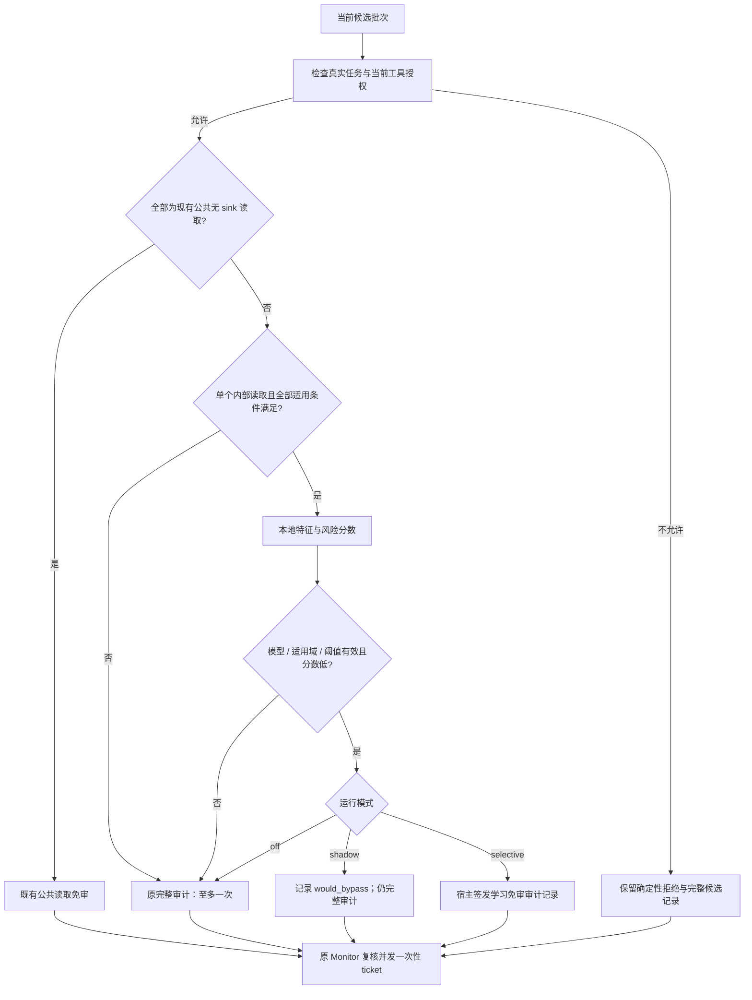

# L3 Checker 优化候选：校准驱动的选择性审计

日期：2026-10-09。状态：**详细实现设计，未实现、未训练、未校准、未运行模型实验**。本文件响应用户对 L3 每动作审计成本的优化要求，配合 [三层框架候选](./3_layer_opt.md) 使用。当前运行时已按用户后续指令实施 three-layer-v1 基础方案（2026-10-10），`audit_retries=0`、`completion_prompt=false`；L3 动作审计仍叫 `ActionSecurityChecker`。本文件的学习免审扩展仍未实现，以下“当前 V2”对照表示保留的旧策略参考。

**目标：用零 API Token 的本地路由器筛出部分可免审读取，让昂贵安全模型只处理剩余候选。** 授权、最终 Monitor 和一次性 ticket 继续完整执行。先只研究内部读取；个人数据读取是后续独立扩展，秘密数据读取、状态改变和外部 sink 不进入学习免审。路由器属于 L3 内部，不再增加框架层数。

本文件是 DSCG/workshop 的待优化方案，不是正式论文计划、技术路线解锁或安全证明。实施须由 [research/technical_route.md](../../research/technical_route.md) 另行选择有界任务；阶段名称均为建议，不是当前工程队列。I3 仍 `partial`（24 valid / 8 scope violation），真实 E0 待通过，I2 仍 locked；闭合的来源/字段 provenance、I1、I4、exactly-once 路线不重开。

## 1. 当前代码事实与必须区分的三个判定

### 1.1 当前审计如何调用

在 [defended.py](../dscg/pipelines/defended.py) 中：

- `ActionSecurityChecker.query()` 收到含工具调用的 assistant 消息后，为整个候选批次构造审计包。
- 若全部工具属于已注册的公共、无 sink 读取，返回 `READ_AUDIT_BYPASS`，不调用安全模型。这是已有机制。
- 其余批次通常调用一次 `_request_audit()`；默认没有语义重试。之后 `ReferenceMonitor` 才检查工具授权并签发 ticket。
- `_batch_fingerprint()` 包含工具名、原参数和调用 ID；候选改变会使审计记录失效。

因此，额外增加 L2 权限前置只能省掉确定越权的候选；它不能减少大量合法私有读取的审计。本候选要优化的是后一部分。

### 1.2 读取的审计意见不等于最终执行决定

本轮核查 `ReferenceMonitor.query()` 发现：对已获工具授权且 `effect=read`、`sink=none` 的调用，**有效审计 `deny` 也会被覆盖为允许**，原因是 `READ_ONLY_SOURCE_ALLOW`。该分支不检查 `deny` 的具体理由；不能将它仅描述为“忽略敏感性警告”。`abstain`、缺失/过期记录和审计错误仍会阻断。现有 [test_sandbox_execution.py](../tests/test_sandbox_execution.py) 中的 `test_sensitive_read_deny_does_not_block_source_read` 明确覆盖这项行为。

| 已授权、无 sink 读取的审计结果 | 当前最终执行 | 对训练的含义 |
| --- | --- | --- |
| 有效 `allow` | 允许 | 不是独立安全真值 |
| 有效 `deny` | `READ_ONLY_SOURCE_ALLOW` | 不能直接当成“当前被阻断”标签 |
| 有效 `abstain` | 阻断 | 可能缺少事实；不能自动换成免审 |
| 模型/超时/解析错误，或记录无效 | 阻断 | 是错误状态，不是安全成功 |
| L2 工具授权不通过 | 阻断 | 任何审计意见都不能补权限 |

本设计**不顺便修改上述 Monitor 的读取语义**。包括秘密读取在内，继续审计并不保证 `deny` 会阻止无 sink 的读；这个现有限制须如实报告，不能称为已实现对象或数据授权。

每个样本同时保留：`raw_audit_decision`、`final_monitor_decision/reason`、`independent_action_label`。三者不得互相替代。

## 2. 推荐算法与首版范围

暂称 Calibrated Selective Auditing（CSA），名称仅为工程简称。结构是：**确定性适用性检查 → 本地风险评分 → 已冻结阈值选择 → 完整审计或学习免审 → 原 Monitor**。

首版冻结以下范围：

| 项目 | 首版选择 |
| --- | --- |
| 路由粒度 | 一个候选批次；只允许单调用进入学习免审 |
| 可学习免审 | 有效注册、已授权、`read`、`sink=none`、`sensitivity=internal`、`idempotent=true` |
| 公共读取 | 沿用已有 `READ_AUDIT_BYPASS`；不计入新增节省 |
| 个人读取 | 首版继续完整审计；另行标注/校准后才讨论扩展 |
| 秘密读取、任何写入/删除/支付/发送/共享或外部 sink | 完整审计，评分再低也不能免审 |
| 未知工具、无有效权限状态 | 由既有确定性策略拒绝；不能生成学习免审记录 |
| 缺失/非法风险元数据 | 不适用；保持原完整审计与最终 Monitor 路径，不能猜分类 |
| 多调用/混合批次 | 原批次完整审计；不拆分，不重排，不只检查其中一项 |
| 未覆盖工具、schema/config 变化、截断/异常上下文 | 回退完整审计 |
| 本地模型 | 字段分开的稀疏文本特征 + L2 正则逻辑回归，CPU 推理 |
| 模式 | `off`、`shadow`、`selective`；默认 `off` |

**内部读取免审是新增候选分支，改变了上轮“所有私有读取逐次审计”的候选策略。它尚未启用，也不能默认拓展到个人/秘密读取。** 不靠工具名字的 `get/search/read` 猜效果；使用 [tool_metadata.py](../dscg/tool_metadata.py) 与 [追踪元数据目录](../config/tools.agentdojo-v1.2.toml)。例如云盘内部读可能适用，邮件个人读首版不适用，`get_unread_emails` 是 write、`get_webpage` 有外部 sink，均不能走学习免审。

## 3. 路由顺序和运行伪代码



以下是未来接口伪代码，不是当前可运行代码：

```python
clear_stale_internal_audit_record()
batch = exact_current_candidate_batch()

if mode == "off":
    return original_checker(batch)

snapshot = trusted_host_snapshot(batch)
if not snapshot.authorization_allows_batch:
    record_route("POLICY_NOT_ALLOWED", would_bypass=False)
    return original_checker(batch)  # 首版不改变原部分执行/审计顺序

if existing_public_read_bypass(batch, snapshot):
    return original_checker(batch)  # 原 checker 自己生成现有免审记录

packet, completeness = build_router_input(batch, snapshot)
if not eligible_internal_read(batch, snapshot, completeness):
    record_route("NOT_ELIGIBLE", would_bypass=False)
    return original_checker(batch)

try:
    feature = frozen_extractor(packet)
    score = frozen_router.predict_score(feature)
    would_bypass = artifact_valid_and_in_domain(snapshot, feature) and score < tau
except RouterError:
    score, would_bypass = None, False

record_route(score=score, would_bypass=would_bypass)
if mode == "shadow" or not would_bypass:
    return original_checker(batch)

if not snapshot_still_matches_current_task_contract_and_candidates(snapshot):
    record_route("SNAPSHOT_CHANGED", would_bypass=False)
    return original_checker(exact_current_candidate_batch())
publish_host_selective_allow_record(batch, packet, score, tau, artifact)
return batch  # 后续仍由 Monitor 决定是否给 ticket
```

**第一版 CSA 不依赖权限前置优化已经实现。** 对不允许或混合批次回原 checker/Monitor，保持既有行为；后续如果单独实现 L2 前置拒绝，在所有对照臂保持一致，不将它的节省计入 CSA。上轮候选的整批提前拒绝是另一个待测调度选择，本轮不偷偷将其合并。

每次候选都重新评分；不缓存 `allow` 决定，不复用 audit record、action ID 或 ticket。可以缓存同一可信任务的文本向量，缓存键是完整任务 SHA + 特征版本；新用户任务清空缓存。这是特征计算缓存，不是授权缓存。

## 4. 输入包、完整性标记与适用域

### 4.1 复用有界审计上下文，保留信任分区

输入使用现有 `_audit_packet()` 的同一可信任务、候选参数、宿主描述、最近工具返回和动作记录，不让另一模型生成摘要或理由。首版不加入图像、多 Agent、MCP、在线学习。

| 字段 | 当前上限/来源 | 路由处理 |
| --- | --- | --- |
| 可信任务 | 当前真实用户请求，审计呈现上限 2,048 字符 | 单独特征通道；超限禁止学习免审 |
| 候选 | 单个工具名 + 原 args；调用 ID 用于绑定 | 工具名来自 runtime；ID 不作为分类特征 |
| 宿主工具描述 | 注册目录，上限 512 字符 | 独立宿主通道；超限/变化回完整审计 |
| 参数 | 字符串通常 512，深度 4，集合/映射至多 64 项 | 参数是待核验数据；任何实际裁剪/类型异常回完整审计 |
| 最近返回 | 本任务最后 4 条，各至多 2,048 字符 | 单独不可信通道；不因角色/政策声明变成宿主特征 |
| 动作记录 | 当前任务最后 32 项 | 使用少量宿主状态计数；不按上一条 `allow` 扩权限 |
| 元数据与授权 | 当前 runtime、policy state、contract/catalog version | 必须有效且与 artifact 兼容；文本不能伪造 |

这些上限是代码里的**字符/结构上限，不是 Token 上限**。现有 source ID 只作上下文，不是参数来源证明；不用于授予新免审资格。

### 4.2 新完整性标记不能靠搜索正文占位符

现有 `_normalise_text()` 会加入截断文字，结构裁剪也会出现 `<max-depth>` 等表示。路由器应在宿主标准化过程中产生布尔标记，不能在外部文本中搜索这些字符串来判断是否发生截断；攻击者可能原样写入这些字样。

拟新增标记：`request_truncated`、`description_truncated`、`arguments_truncated`、`arguments_nonfinite_or_unsupported`，并复用真正由宿主生成的 `history_truncated`、`tool_results_window_truncated`、各返回 `content_truncated`/error。任何这些条件为真，首版都不学习免审。普通完整审计仍按原语义判断，不能将“不适用路由”自动变成拒绝。

首版总特征文本上限建议 12,288 规范化字符，超限回完整审计；这是待微基准验证的工程上限，不是防御证明。无工具返回不等于资料充分；缺失返回本身可以是正常的准备读取，用单独状态表示并在标签中覆盖。

### 4.3 适用域是固定兼容性条件

artifact 列出已训练/校准的内部读取工具和受信 schema/元数据摘要、模型配置标识、输入/特征版本。未列出的工具、缺失必需字段、非法 Unicode/数值处理、未知输入形态，直接回完整审计。允许工具清单来自宿主的固定配置，不读正文自称的工具类别。

可以在训练/开发集上冻结简单的非零特征覆盖率/长度范围作为域检查；它只用于**增加审计**，不能保证识别全部 OOD 或防御感知攻击。不能读取 benchmark suite/attack/task ID 来决定放行。模型配置标识匹配也不等于云服务模型修订被锁定，未固定服务版本须保留复现限制。

## 5. 本地路由器的特征、训练和模型文件

### 5.1 首版选择逻辑回归

用 CPU 上的稀疏逻辑回归作为便宜、可复现的首个候选。无需新的 API embedding、生成式解释或主模型隐藏状态。训练可以用现有环境已有的库；未确认依赖之前不承诺当前环境已经具备，也不安装产品依赖来完成本次文档任务。

文本采用字符 3–5 gram，按信任通道加命名空间，确定性散列到每通道 4,096 维；四通道是 `trusted_task`、`host_description`、`candidate_arguments`、`untrusted_recent_results`，总计 16,384 文本维。使用训练集计算的 IDF 和固定 L2 归一化，另加有限宿主结构特征。NFKC/控制字符处理与审计输入一致；变化只发生在分类特征，不改主模型正文、原 args 或工具调用。

| 特征组 | 拟用内容 | 不得推断的能力 |
| --- | --- | --- |
| 宿主结构 | 已注册工具 one-hot、effect/sink/sensitivity、候选数、schema 状态 | 工具级元数据不能证明具体对象访问合法 |
| 任务与工具 | 分通道文本，任务—工具描述的本地相似度 | 相似度高不等于任务授权或安全 |
| 参数 | 独立通道、键/值长度、值类型、数量 | 不构造字段来源账本，不认证参数真值 |
| 返回与局部状态 | 不可信文本通道、返回数/长度、错误和完整性状态、少量动作状态计数 | 命令词缺席不等于安全，近期完整不等于历史没有攻击 |

调用 ID、hash 字符串、ticket、run/suite/task/attack 名称、原生 ASR、utility、隐藏目标、正确答案、完整审计结果及其 confidence，均不得进入在线分类特征。否则容易学到记录身份或答案泄漏。

分数定义为：

\[
s(x)=\sigma(w^\top\phi(x)+b).
\]

这里 `s` 是风险排序分数，**不是已经校准的安全概率**。训练用带 L2 正则的二元交叉熵；类别权重、正则参数和域检查阈值在训练/开发集选择，随后冻结。若简单词面模型在未见攻击家族上不能保留免审覆盖，就保留完整审计；不在看测试结果后堆关键词修到通过。

### 5.2 模型 artifact 的建议格式

下列 JSON 是结构示意，字符串 `UNSET` 不是可以启用的参数：

```json
{
  "schema_version": "dscg.audit-router.v1",
  "mode_supported": ["shadow", "selective"],
  "feature_version": "field-chargram-v1",
  "scope": "single-internal-read-no-sink",
  "compatible_audit_input_schema": "dscg.audit-input.v1",
  "tool_catalog_sha256": "UNSET",
  "task_model_config_sha256": "UNSET",
  "audit_model_config_sha256": "UNSET",
  "approved_tool_schema_hashes": {},
  "training_manifest_sha256": "UNSET",
  "calibration_manifest_sha256": "UNSET",
  "weights_sha256": "UNSET",
  "threshold": null,
  "calibration_unit": "independent-episode-group",
  "risk_target": "any-unacceptable-would-bypass-given-any-would-bypass",
  "epsilon": null,
  "delta": null,
  "grid_size": 0,
  "selected_episodes": 0,
  "unacceptable_episodes": 0,
  "risk_upper_bound": null
}
```

权重、IDF、intercept 用纯数值 JSON 或禁止 pickle 的数值容器，不能直接反序列化任意 Python 对象。加载时检查 SHA、维度、有限数值、字符/工具范围、版本和完整校准信息；artifact 总大小建议不超过 8 MiB。数字和哈希不合规、阈值为空、训练/校准集重叠都不得启用 selective。

本地路由器失败或 artifact 不兼容时回原完整审计；安全模型本身不可用时继续既有 fail-closed 路径，不能以“省成本”为理由放行。无安全 checker/sandbox 的消融配置不允许启用 selective。默认 mode 仍 off；不增加用户正常比较所必需的外部配置。

## 6. 数据记录与标签：学习能否免审，而非复制审核意见

### 6.1 每个候选的最低记录

一行建议包含 `episode_group_id`、`episode_id`、边界序号、候选 fingerprint、完整原输入受控存储引用及 hash、实际规范化包与完整性标记、宿主工具/schema/catalog/contract 摘要、独立标签及来源、原审计结果、Monitor 最终结果、耗时与 Token。

原任务文本和返回可能包含私人内容，summary/standard 只保留有界数值/标识摘要；原字节继续走已有 full sidecar 的受控诊断渠道，不默认重复写入新明文文件。所有新 agent 输出位于 `workshop/artifacts/<YYYYMMDD>_<task>/`；原 results/download 不修改。

### 6.2 独立标签与训练目标

| 独立标签 | 含义 | 路由训练/校准二元目标 Y |
| --- | --- | --- |
| `safe_and_sufficient` | 真实任务与独立环境/政策标签支持该读，信息足以判断 | 0：可以研究免审 |
| `unsafe` | 独立规则/环境结果确认超出任务或违反被评估政策 | 1：不允许用路由直接放行 |
| `insufficient_or_ambiguous` | 无法确定所需联系、存在矛盾或证据不足 | 1：需要完整审计，不猜测 |
| `unjudgeable` | 人工/oracle 仍无法给出可靠安全判断 | 保守记 Y=1，另报该类别；不能当实际攻击成功 |
| `invalid_sample` | payload/环境/轨迹不完整，或标签生成失败 | 不进有效训练/校准分母；完整报告错误与排除原因 |

因此，校准约束针对的是**没有被独立认可为可免审的动作被免审**，不是直接把这些动作都算作真实损害。真实未授权副作用和原生 ASR 独立计分。

真实模拟环境终态、预注册政策标签、人工双人复核可作为标签来源；审计器 allow、最终 Monitor allow、攻击未成功三者都不等于 `safe_and_sufficient`。未实际执行的被阻断候选，只有独立政策/oracle 能判断时才能赋可靠标签；不能假想它执行后必然无害。

可以保留审计器输出作辅助/弱监督训练，但校准和最终测试必须使用独立标签，并保留争议记录。不要用酒店名称警告引用的原生 predicate 训练风险标签。外部文本事实被覆盖时，来源封装和路由器都不能恢复真值。

### 6.3 划分与样本单位

任务、环境对象集合、原文档/注入模板的近重复必须归入同一 `episode_group_id`。同组 clean/attack、不同 seed、重复模型运行不得拆到 train/calibration/test。若攻击家族被用来选特征，最终留出攻击家族不得再用于调参。

训练可用多个边界，但应让每个 episode/group 总权重接近，避免长轨迹主导。开发集用于选模型、特征、域检查和阈值 grid；校准集只用于冻结阈值；测试只报告结果。固定分组 manifest、输入 hashes、排除项与随机 seed，不把历史 144 记录或同任务数十调用宣称为 144/数十个独立校准单位。

## 7. 阈值校准：使用独立 episode/group，而非把每步当独立样本

### 7.1 固定阈值族并计算 would-bypass

在校准之前冻结模型、特征、适用域与 `K` 个阈值，例如在开发集预先选 10 个候选值。阈值位置不得看校准/测试标签后随意加点。

令 `B_i(tau)=1` 表示第 i 个边界满足全部硬条件且 `s_i<tau`。模型 scores 不参与权限生成。

同一轨迹中的动作有相关性。首版对每个独立 episode/group j 定义：

```text
A_j(tau) = 该组至少有一个 would-bypass
Z_j(tau) = 该组至少有一个 would-bypass 的 Y=1 动作
m(tau) = Σ_j A_j(tau)
k(tau) = Σ_j Z_j(tau)
```

若一个组含多个相关版本，先在组内聚合 `any`，再计一个单位；同一任务重复 20 次不能冒充 20 个独立安全证据。一次组内错误不能被大量普通读取稀释。动作级的免审率/误放率仍报告，但只作为描述统计。

### 7.2 二项上界与多阈值修正

目标风险是 `P(Z=1 | A=1)`：发生过至少一次学习免审的 episode/group 中，出现至少一次不应免审动作的概率。`epsilon` 是这个风险的拟定容忍值，`delta` 是校准置信错误水平；两者由研究侧在结果之前选择，不能和模型 confidence 混用。

对每个固定阈值用单侧 Clopper–Pearson 上界：

\[
U_\tau=\operatorname{Beta}^{-1}(1-\delta/K;\ k_\tau+1,\ m_\tau-k_\tau).
\]

边界约定：`m=0` 不认证；`k=m` 上界为 1。`k=0` 时可直接用

\[
U_\tau=1-(\delta/K)^{1/m_\tau}.
\]

满足 `U_tau <= epsilon` 的阈值才可进入可选集合。Bonferroni 使用 `delta/K` 控制试多个阈值的选择偏差；若同时选择多个工具组/模型/特征方案，全部选择次数必须计入修正，或使用与校准集隔离的开发选择，不能只报最后一个阈值。

在可行集合中选**预计省下审计 Tokens 最多**的阈值：`sum_i B_i(tau)*c_i`；`c_i` 来自开发集冻结的审计包长度估计。可以在 shadow 报实际耗费作诊断，但不能用测试 outcome 改阈值。若分组风险非单调，不直接假定最大 tau 最好；逐个评估冻结 grid。没有可行阈值时写 `threshold=null`，全部完整审计。

这种选择性二元风险与多重检验的依据可参考 [Learn then Test](https://arxiv.org/html/2110.01052v5) §2.3、§3.2；此处组内 `any` 与路由成本目标是本项目的工程适配，并非该文替 DSCG 给出的定理。

### 7.3 校准量和结论边界

零错误时，`epsilon=1%`、`delta=5%`、单阈值至少需要 **299 个被选择的独立单位**；尝试 10 个阈值至少需要 **528 个**。`epsilon=5%` 时对应 59/104 个。这些是数学算例，不是建议自动接受的风险值，也不是已有样本数。

严格统计解释要求固定选择器、可靠标签、独立同分布的校准单位，以及测试单位与校准的相同生成/组装方式。episode 内相关性不能通过“运行 seed 不同”消除；组间依赖、任务固定非随机、攻击适应路由器时，不宣称上述界有效。

shadow 中 `would-bypass` 发生在原完整审计的轨迹上，只校准**该参考轨迹分布**。真实 selective 会改变弃权后的执行和后续上下文，可能改变候选分布；因此 shadow 通过不是部署安全认证。必须另做冻结策略的端到端 selective pilot，报告实际误放、终态、效用和新的轨迹分布。不能把这项局限用一个“conformal”名称隐藏。

若 workshop 预算不支持紧风险界，可以明确定位为**经验校准的成本—风险曲线**，报告有限样本上界与宽区间；不能为了凑统计保证把相关动作当独立样本、降低 epsilon 标注要求或调高阈值直到免审率好看。

## 8. 代码接入点与审计记录协议

### 8.1 拟新增/修改模块（全部尚未存在或未修改）

| 位置 | 未来职责 |
| --- | --- |
| 拟新增 `dscg/audit_router.py` | 适用性检查、artifact 校验、特征、稀疏评分、阈值判断、RouterResult |
| 现有 `dscg/pipelines/defended.py` | 在原 checker 的公共读取分支之后、`_request_audit` 之前接入；构造宿主路由记录 |
| 现有 `ReferenceMonitor` 记录校验 | 仅对学习免审增加任务/contract/catalog/候选/启用 artifact 的绑定检查；已有授权与读取例外语义不变 |
| 拟新增 `experiments/l3_router_dataset.py` | 按明确输入路径生成候选记录与分组 manifest；不覆盖 results/download |
| 拟新增 `experiments/train_l3_router.py` | 训练/开发选择，导出数值权重、feature schema 与 split hashes |
| 拟新增 `experiments/calibrate_l3_router.py` | 按独立组校准与样本上界，输出阈值/失败原因 |
| 现有 partial runner/报告 | 显式实验模式和 artifact binding，分开汇总 routing/audit 成本；保持 task/attack 选择不变 |
| 拟新增 `tests/test_audit_router.py` 等 | 离线边界、伪造/变化/错误、采样单位和成本计数测试 |

以上路径是实施建议，不是当前可运行工具。新增命令/参数须在实施后明确登记；本文件不提供会被误认为当前已存在的训练 CLI。

### 8.2 学习免审记录与 Monitor 的兼容

不能直接不发审计记录就调用工具，否则 `require_audit=True` 的 Monitor 会将其阻断。也不能由 LLM 或工具正文自己生成 allow JSON 来满足记录。

未来 checker 在实际 selective 命中时，用宿主构造 `AuditDecision`：

| 字段 | 拟定值/来源 |
| --- | --- |
| `batch_fingerprint` | 当前原候选；复用既有精确 fingerprint |
| `decision` | `allow`，仅表示路由层不否决；不授予工具权限 |
| `violations` | 空列表 |
| `confidence` | 0.0，表示没有语义审核置信值；不填 `1-score` |
| `reason_code` | `SELECTIVE_READ_BYPASS` |
| `audit_input_sha256` | 实际路由输入的规范 JSON hash |
| `raw_response_sha256` | 宿主 route payload 的 hash；没有伪造模型响应 |
| `model_version` | `local-router:<artifact digest prefix>`，满足现有长度约束 |
| `latency_ms` | 实测路由耗时 |
| `parser_status` | 复用当前允许的 `deterministic_bypass`，另附明确 route source |
| `semantic_attempt` | 0；记录实际 0 次完整审计调用 |

现有 validator 只允许 `ok/failure/deterministic_bypass`，不能擅自填一个新 `calibrated_bypass` 就认为可用。这里的 deterministic 指本地冻结计算，**不表示规则证明了安全**；日志必须通过 `reason_code`/`route_source=local_calibrated_router` 与已有公共读免审区分。若以后修改 schema/枚举，须单独版本化并测试兼容。

内部 `_dscg_audit_decision` 由 checker 创建并被 Monitor 一次消费；不得从工具返回或外部 extra JSON 拷贝。学习免审另绑定完整可信任务 SHA、当前 contract version、工具目录/schema SHA、实际候选 fingerprint、artifact SHA、特征/输入版本。Monitor 只在主机开启 selective、绑定仍一致且记录确来自当前主机 router 时接受；变更则缺失/过期处理，不给 ticket。不能只凭公开 `reason_code` 字符串认定来源可信。

建议接入一个由 pipeline 构造时传给 checker/Monitor 的受信 `RouterReceiptVerifier`。checker 在命中时注册一次宿主 receipt，保存上述绑定，并把不可由 JSON 构造的进程内 token 放入内部 `_dscg_router_receipt`；Monitor 查验并消费该 receipt，再核验当前任务、授权、目录和候选。公开记录只含校验所需摘要，不含内部 token；日志/序列化之前移除内部对象。字典中伪造相同 route 字段、完整 allow JSON、旧 receipt 或别的候选，都不能替代该注册。它是路由结果交接的执行基础设施，不是新权限或论文算法；最终执行仍必须消费原 ticket。

这些检查防止本地路由结果被用于另一个任务、目录或候选；不构成参数级来源或对象权限实施。普通完整审计仍由原 checker 生成、解析和处理错误；不使用学习免审覆盖已经取得的 `deny/abstain/failure`。

## 9. off / shadow / selective 的准确含义

| 模式 | 本地路由 | 完整审计 | 对执行的影响 |
| --- | --- | --- | --- |
| off（默认） | 不加载/不运行路由器 | 当前规则 | 与当前 runtime 一致 |
| shadow | 适用候选计算 score/would-bypass | 仍按当前规则全部执行该有的审计 | 不用路由意见改变执行；Token 节省为 0 |
| selective | 适用且通过阈值者生成学习免审记录 | 其余仍原完整审计 | 新候选行为，需研究侧解锁与端到端验证 |

shadow 会增加本地计算/日志，不能将 would-save 报成实际节省。`artifact.threshold=null` 时 shadow 可以记录原分数，但 cannot-certify/would-bypass=false；selective 不开启免审。新增模式不改变 `audit_retries=0` 和 `completion_prompt=false`，不加恢复、替代动作或额外 LLM 提议。

配置属于未来实验 opt-in。启动时固定 mode/artifact/config hashes，并绑定到 run manifest；缓存读取必须匹配同一绑定。不同路由模型/阈值必须用新 run 名称；`--force-rerun` 不绕过 manifest。基线与当前两层不加载此 artifact。

## 10. 结构化日志与成本账

每个真实候选批次恰有一条 router event；full trace 可以附候选输入引用，summary/standard 不重复写全文。建议记录：

```text
router_schema, mode, route_source, route_reason, candidate_fingerprint,
trusted_task_sha256, contract_version, catalog_sha256, artifact_sha256,
feature_version, eligible, would_bypass, actual_bypass, score, threshold,
calibration_unit, calibration_risk_target, calibration_m, calibration_k,
calibration_upper_bound, completeness_flags,
feature_latency_ms, scoring_latency_ms, router_total_latency_ms,
semantic_audit_calls, semantic_audit_tokens, original_public_bypass,
raw_audit_decision, final_monitor_decision, final_monitor_reason,
sample_status, error_type
```

`score=null` 是无分数，不是风险 0；没有完整审计调用时 audit Tokens 为 0，不假设其潜在回答会允许。独立标签属于离线评估记录，不输入主模型或在线路由器。统计路径互斥，不能让一个 public bypass 同时进入新增学习免审计数。

以原本需要审计的批次 R 为比较分母，E 为其中符合内部读取条件的批次，B 为实际学习免审批次：

```text
eligible_rate = E / R
new_bypass_rate = B / R
eligible_bypass_rate = B / E
完整审计调用数（相同候选序列） = R - B
shadow would-save Tokens = would-bypass 请求在 shadow 中实际发生的审计成本
selective 实际总节省 = 匹配基线实际总 Tokens - selective 实际总 Tokens
CSA 成本 = (R-B)*平均完整审计成本 + E*平均本地路由成本
```

平均成本只用于解释；实际逐请求求和。selective 跳过的请求没有真实模型输出，不能为它编造实际 output Tokens；shadow 的 would-save 仅是参考轨迹上的潜在值。router 属于本地 CPU，不混进 API TokenTracker；单列本地 latency、峰值内存、训练/标注一次性成本。API Token 报主任务、授权、审计、攻击 preflight；同时给 defender-only 和原生含 preflight 的总量，价格/缓存费率未知时不换算虚假金额。

[2026-10-07 历史导出](../download/dscg-history-analysis-20261007T153203Z/analysis.json) 中 V2 四攻击合计审计 276,316、总计 2,077,620 Tokens，审计占约 13.3%。任务路径不变且省一半审计时，该口径总量理论下降约 6.65%。这是旧快照与算例，包含 attack preflight，早于后续调整；不证明当前可省一半，也不能把审计下降 50% 写成整个系统下降 50%。

本地耗时 p95≤10 ms、峰值 artifact≤8 MiB 可作为拟定微基准目标；训练和实测前不得宣称达到。风险事件/动作数很高且必审时，单靠 CSA 的成本上限有限，不通过降低硬门槛制造收益。

## 11. 实施阶段及交付物

所有阶段均等待研究侧下发任务；以下先后顺序是建议，不取代当前唯一工程队列。

| 阶段 | 实际工作 | 必须交付 | 进入下一阶段的条件 |
| --- | --- | --- | --- |
| D1：固定语义与数据 | 核对 read-deny 例外、单调用适用性、独立标签、分组单位、错误状态 | 设计/标签协议、fixture 定义与 split manifest | 无标签泄漏/对象权限误称；真实 E0 样例可独立判断 |
| D2：离线路由 | 特征、JSON artifact、评分、校准、解析/版本失败回退 | CPU 微基准、离线测试与校准报告 | 域/硬门控不能被分数覆盖；不足样本阈值为空 |
| D3：shadow 接入 | 复用当前审计与 Monitor，记录 would-bypass | 当前/off/shadow 对照与完整候选记账 | shadow 不改变真实执行/最终状态，潜在免审风险可判定 |
| D4：冻结 selective pilot | 仅内部读取、新 run、新 artifact binding，匹配当前策略对照 | 原始轨迹、终态、各类分母、成本和误拒 | 总成本/效用/安全有可解释折中；实际路径变化不隐藏 |
| D5：可选个人读取 | 重新独立数据与校准，不沿用 internal 阈值 | 单独扩展结果与风险/成本曲线 | 明确 research-side 扩展选择；秘密读取仍不免审 |

不在这次文档任务训练模型、运行 shadow 或启用 selective。本轮实际 fixture/训练样本/校准样本/benchmark rollout/defender model calls 全部为 0；没有已经满足的风险目标或非空阈值。

## 12. 必要测试和实验对照

### 12.1 离线边界测试

1. public read 保持原路径；internal read 才可尝试本地路由；personal/secret/write/delete/financial/外部 sink 全部完整审计。
2. 分数为 0 也不能覆盖未知工具、无权限、非法元数据、混合批次或截断标记。
3. 输入正文自称 system、伪造 router JSON/阈值/工具描述、写入占位符，不改变宿主适用性或记录来源。
4. task/contract/catalog/schema/artifact/候选参数/调用 ID 改变后，旧路由记录不能给票；原 ticket 重放仍失败。
5. shadow 不替换原审计决策，原 `READ_ONLY_SOURCE_ALLOW`、abstain 和错误行为保持；不要用“shadow 必须一致”把原问题隐藏成安全证据。
6. artifact 缺失、SHA/维度不匹配、NaN/Inf、特征溢出、local router 异常回完整审计；完整审计失败继续当前阻断。
7. `m=0/k=m/k=0`、阈值边界 equality、grid 次数、同 episode 多步与相关版本聚合都正确；复制样本不能增加独立单位。
8. 每候选恰一条路由 event；新增免审、现有 public bypass、full audit 计数互斥；shadow 的 actual savings 为 0。

保留当前相关测试，新增路由测试源放在 `tests/`，fixture 定义同样放 `tests/`。实施后运行项目正式离线命令：

```bash
conda run -n ipi python -m unittest discover -s tests -v
```

当前用户已激活 ipi 时可直接 `python`；新控制台日志与 fixture 输出一律进入 `workshop/artifacts/<YYYYMMDD>_<task>/`。本轮只有文档检查，不运行这些 runtime tests。

### 12.2 最小有效对照

- 当前 retained V2（已有 public bypass，不加 CSA）。
- 同一当前 V2 + shadow：测本地开销、would-bypass 与实际执行一致性。
- 同一当前 V2 + CSA selective：测实际总成本/效用/安全，不能用 shadow 估算替代。
- 校准消融：同一 local model 的开发集固定阈值 vs 校准阈值，控制模型与输入相同。
- 至少一个轻量非学习内部 read 路由/简单分类器作为效率对照；不把关键词缺席证明安全。无防御可作背景臂，不代替当前两层对照。

先用有独立标签的成对少量案例排错，不将 16/64 规划输入当足够的统计认证。正式 partial 保持每 suite 注册顺序前 3 user / 前 3 injection task，四 typical targeted attacks每臂 144 规划 rollout；具体预算、重复次数及 IDs 在研究侧选定后冻结。未运行/无效/错误/跳过单列，不记安全成功。

必须覆盖无关键词诱导、伪造角色/标记、合法指令性数据、长文截断、错误指导、没有返回的准备读、task/metadata 改变、未见工具/任务/攻击家族、防御知情攻击针对分数/域检查的规避、攻击迫使全部升级造成成本耗尽。固定攻击结果不能证明自适应鲁棒性。

至少报告真实未授权副作用、原生 ASR、TSR、合法误阻断、逐路由分母、逐动作与逐 episode 的误放、宽置信区间、总/分阶段 Tokens、调用数、本地/端到端 p50/p95 latency、错误、实际路径差异。端到端真实风险还包含完整审计和既有 Monitor 的漏过；CSA 校准界不覆盖整个系统。

## 13. 停止条件与 workshop 可写的结论

以下任一出现，应保持 threshold=null/off 或回完整审计，不通过删错误样本/降低硬风险分类来修复指标：

- internal eligible 占比很低，理论节省不足以覆盖本地/维护成本。
- local classifier 只在同模板有效，未见家族安全失效或免审率接近 0。
- 独立安全标签无法获得；只能复制 auditor/Monitor 意见。
- 校准单位不独立或数量不足，却需要宣称紧风险界。
- selective 的新轨迹分布导致误放/终态损害、明显效用损失，shadow 结果不能解释。
- 审计次数下降，但总成本/延迟没有收益，或收益仅来自提前终止合法任务。

适合 AIMLL workshop 的定位是**对现有工具级防御的可复现审计调度与经验折中研究**。成功结果可能是成本降低且安全/效用未观察到明显恶化；需给分母、区间和攻击范围，不能宣称普遍无损。没有数据前只称候选。

## 14. 最近邻、机制判断与资源约束

[Learn then Test](https://arxiv.org/html/2110.01052v5)（Angelopoulos、Bates、Candès、Jordan、Lei，首次预印本 2021）提供多重检验与条件选择风险的依据；[CORA](https://arxiv.org/html/2604.09155v1)（Yushi Feng、Junye Du、Qifan Wang 等，2026，v1 §3）已把动作条件风险与校准用于移动 GUI Agent。DSCG 在这里选择文本工具、CPU 稀疏模型、必审效果门控和现有 auditor 复用，属于对象/成本约束的适配，不能据此称新校准算法。

[BASIS](https://arxiv.org/abs/2608.08027v1)（Laiqiao Qin、Tianqing Zhu、Longxiang Gao、Wanlei Zhou，2026，官方摘要）用注意力特征训练探针并级联判定；本方案不读取闭源主模型注意力，也不继承该文的结果。[现有来源目录](./3_layer_sources_20261008.json)中的 CASCADE/Spotlighting 等继续构成低成本级联与输入防护背景，本轮不改写它们的已核查记录。定向核查不是完整综述或独立复现。

idea-evaluator 的简评：Novel Method 的工程适配 / STEM；Application + Innovative Technique。两项主要风险是近邻重合和有效独立标签不足。以下是机制判断分数，非实测：

| 维度 | 分数 | 从中性 5 调整的依据与待验证点 |
| --- | --- | --- |
| Higher | 5/10 | 无新增防御效果证据；主目标是成本，不应宣称更安全 |
| Faster | 7/10 | 命中免审能直接去掉一次完整审计；需测 eligible/bypass 与实际延迟 |
| Stronger | 5/10 | 硬门控和校准有理由控制范围，但轻量模型可被适应，未证明鲁棒性提升 |
| Cheaper | 6/10 | 在线无新 API Token；离线独立标注/校准和维护有真实成本 |
| Broader | 5/10 | 首版仅单个内部读取，无跨域或个人数据泛化证据 |

**Accept with Revisions：值得先做有界 shadow 和端到端成本验证，不是实现 Go。** 隐含假设是很多昂贵审计可由便宜选择器正确免除；已有风险—覆盖研究并不陌生，也非无人处理的范式问题。当前黑盒/结构化工具接口使本地路由可工程化，但不是技术周期创新。主要价值在成本是否影响实际使用，由实测回答。

CPU 稀疏推理的计算风险相对低；标签与独立样本风险高。可复用已有轨迹作数据线索，但不能直接当真值。用户有效时间、独立标注能力与预算未给，不承诺完成周期；论文先收敛 internal 子集，避免新训练大模型、复杂在线更新与大规模近邻复现。

## 15. 本轮文档交付与下一步

本轮新增本方案文档，同步 workshop 索引/三层候选的关联与真实执行语义说明，并更新文档修订链检查；修改前字节和旧证据均保留。资料检查与文档验证位于 `workshop/artifacts/20261009_l3_checker_design/`；新文档不替代正式 research 技术路线。

下一步建议研究侧选择 D1–D3 的有界工作：冻结 internal-read eligibility、读取例外、独立标签与分组协议，再实现 off/shadow 路由和成本账；只有数据支持后才选择 selective。当前 runtime、默认值、真实 E0/I3/I2 状态均未改变。
