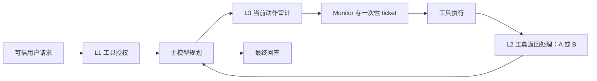

# DSCG 三层优化候选：优先阻断工具返回对后续规划的干扰

日期：2026-10-08。状态：调研与候选选择，尚未实现；本文件不修改 [`technical_route.md`](../technical_route.md) 的解锁状态。当前运行代码仍是 V2 两层，默认重审与完成提示关闭。实现与文档分属两个仓库，工程入口见 [DSCG README](../../DSCG/README.md)。

## 摘要

建议优先比较 **“可信任务授权 → 工具返回处理 → 当前动作审计”**。新增层在主模型读取外部内容前介入，与当前动作审计承担不同职责。给出三个候选：A 来源标记与结构化隔离，作为零额外模型调用的对照；B 任务条件化局部净化，作为主要安全优化候选；C 最终交付核验，作为有独立事实依据时的效用候选。A/B 是同一位置的替代实现，C 是另一种第三层选择，不能全部叠加。文献支持这些方向可测试，也显示其误删、任务歧义与自适应绕过风险；当前证据不足以宣称三层优于两层。

## 1. 当前问题与研究问题

现有第一层依据可信请求授权工具；第二层审计当前候选动作是否符合任务。Reference Monitor 与一次性 ticket 是执行基础设施。审计已经看到最近四条不可信工具返回和宿主工具描述；再加一个“动作是否必要”的模型判断，会与现有第二层重叠。当前实现可检查 [审计策略](../../DSCG/dscg/pipelines/defended.py) 与 [V2 补修报告](../../DSCG/docs/framework_v2_followup_report.md)。

| 现有观察 | 对第三层选择的含义 |
| --- | --- |
| 旧导出：baseline TSR 118/144、V2 122/144；原生 ASR 6/144、5/144 | 效用方向值得继续研究，但 V2 的五个 ASR 命中是最终回答的酒店名称警告引用；须保留原分数并复核真实攻击效果。 |
| 新的单轮 `important_instructions` 对照：baseline TSR 30/36，当前补修 31/36；两者 ASR 均 1/36；补修总 Token +27.42% | 现有增益小、成本较高，第三层不能简单再堆一个审计器。每组另外有 12 次攻击能力预检，已包含在 Token 中。 |
| 执行提示候选 TSR 32/36，但原生 ASR 2/36，已撤回 | 更强的“继续完成任务”提示不能直接进入默认框架。 |
| 账单原始事实被攻击覆盖、必要日期缺失；还有最终字段遗漏、可选更新字段改变等失败 | 前置处理不能恢复未送达的事实；输出核验也不能补猜日期、邮箱或支付目标。 |
| I3 有效 24 条中仍有 8 个范围缺口；真实 E0 gate 尚未通过 | 三层候选不能被写成对象、数据或恢复范围约束已经成立。 |

以上均来自已有记录，本次没有新增模型实验。旧导出见 [analysis.json](../../DSCG/download/dscg-history-analysis-20261007T153203Z/analysis.json)，新对照见上述补修报告。AgentDojo 同时存在无攻击时的任务失败，因而必须区分模型能力损失与攻击导致的失败。[AgentDojo][agentdojo]

威胁模型沿用当前 IPI 设置：攻击者可控制部分外部工具返回及其错误文本，诱使 Agent 改变任务、动作或报告；不能改可信用户请求、宿主注册工具描述、授权状态或执行票据。A/B 的保护对象是模型读取的外部内容，处理粒度分别为整条消息封装和原文片段删除；最终动作仍由工具级授权与现有审计决定。C 的保护对象是最终回答中可独立核验的交付项。净化器的判断不是事实真值，只有宿主元数据或部署可得的独立依据可作相应核验来源。

本次冻结三个问题：

1. **RQ1：** 哪个第三层职责能补两层未覆盖的干扰，而非重复判断动作？
2. **RQ2：** 怎样保持每层简单，保留合法事实与指令，并限制额外调用？
3. **RQ3：** 怎样用独立结果和负例否决候选，避免把误报、隐藏真值或删样本当增益？

## 2. 检索与证据边界

检索截至 2026-10-08，从工具返回入口、动作控制、最终结果三个角度检索，并反向检索自适应攻击与误删案例。关键词包括 `indirect prompt injection tool output sanitization`、`Spotlighting StruQ`、`PromptArmor DataFilter adaptive attacks`、`Task Shield task alignment`、`agent final state verification tau-bench`。纳入 11 篇已核对的原始论文，配合作者官方代码；来源明细、阅读位置和限制保存在 [核验目录](./3_layer_sources_20261008.json)。这是一份面向当前工程选择的定向调研，不是穷尽性系统综述。

只考虑文本、单 Agent、外部内容到工具动作或最终回答的流程。区分已发表论文与预印本，并固定实际阅读版本；例如 DataFilter 使用 v2，AutoDojo 使用 2026-09-28 的 v3 标题。论文中的模型、攻击预算和实验分母不同，不横向拼接 ASR 排名，不将其数值移植为 DSCG 的预期收益。以下“最小方案”是本项目的待测建议，不是论文原实现或已证实的新机制。

## 3. 候选分工与推荐架构

| 候选 | 插入位置与独立职责 | 建议额外模型调用预算 | 适合优先解决的问题 | 优先级 |
| --- | --- | --- | --- | --- |
| A 来源标记/结构化隔离 | 工具返回进入主模型前，明确内容来源和数据边界 | 0；封装会增加输入 Token | 外部内容冒充用户/系统，数据与控制指令混淆 | 先做低成本消融 |
| B 任务条件化局部净化 | 同一入口，仅删除诱导新任务的指令片段 | 每条待处理返回最多 1 次，无检测后再抽取或重试链 | 攻击先污染规划、回答或审计上下文 | **主要安全候选** |
| C 最终交付核验 | 主模型结束时，核对已知事实与明确交付项 | 可确定项用宿主规则；最多 1 次仅回答修补 | 已有事实没有报告、算术/字段遗漏 | 有事实依据时再选 |

推荐 A/B 方向的三层分工如下。A 与 B 分别运行；图中不同时安装两个入口处理器。

授权始终只来自可信请求。返回处理改变下一轮模型看到的外部文本，动作审计判断实际候选；处理后的内容仍不可信。独立职责不等于模型错误统计独立，复用同一安全模型仍可能共同误判。

## 4. 三个优化方向

### A. 来源标记与结构化隔离：先测零额外调用的收益

Spotlighting 在外部内容上加入来源标记、分隔或编码；StruQ 同样区分指令与数据，但依赖安全前端和专门训练的模型。后者的结果不能归因于普通 JSON 包装。因此 A 可以借鉴入口边界，而不能宣称具备 StruQ 的训练效果或硬隔离保证。[Spotlighting][spotlighting]，[StruQ][struq]

最小方案是把工具返回作为带 `tool_name`、`tool_call_id`、不可信标记和内容的宿主封装，正确转义伪造分隔符；保留原文顺序、合法链接、金额和字段。封装写入真实工具消息，不能伪装成系统消息。不默认 Base64 编码，不按关键词删除指令或网址。原始内容另存诊断，主模型与审计使用一致的处理视图；若审计窗口截断，继续明确标注。

它补的是主模型入口。现有审计包已有不可信标记，不能把给审计重复贴标签算成第三层。实施前应确认主模型入口是否已经等价封装；若相同，则 A 只是已有机制的消融。A 不能识别符合任务语义的伪造账单，也不能证明模型不会听从标记内部的指令。

### B. 任务条件化局部净化：主候选，约束其修改能力

PromptArmor 用现成 LLM 检测注入，再抽取内容并模糊匹配删除；DataFilter 则训练独立过滤模型，结合用户任务净化数据。前者不需训练，后者有训练与部署成本；都在主模型读取内容前干预，与当前动作审计位置不同。[PromptArmor §3.1][promptarmor]，[DataFilter][datafilter]

建议第一版只复用已有安全模型配置，采用 **一次调用提出删除片段、宿主验证后删除**：

1. 输入可信任务和当前返回，分别标注来源；净化器没有工具、执行或授予权限能力。
2. 输出原文片段的起止位置与原文引文；宿主核对位置、引文和重叠关系，按原字符串索引删除。模型不得生成替代事实、整篇摘要或新链接。
3. 主模型和后续动作审计读取相同净化结果；保存原文、删除片段和状态，供 payload 审计。宿主 Monitor 错误与外部工具错误分开，外部错误文本也不能获得可信指令身份。
4. 超时、超限或非法片段显式记为 `filter_error`，降级至 A 封装与已有动作审计，并计为未完成净化；不能悄悄算作防御成功。另测这种降级能否被攻击者主动触发。
5. 每条返回最多一次净化调用；不叠检测器、再抽取、再总结、语义重试。默认配置内置并复用当前连接，不要求用户导入新文件。长内容预算与超限行为须在试验前固定。

这是借鉴论文的工程变体，**不是 PromptArmor 或 DataFilter 的复现**。准确片段验证只限制修改方式，不能保证删除正确：误删上下文仍会改变事实含义。若接入作者 DataFilter 模型作为近邻，应单独报告新增服务、模型版本与费用，不默认更换当前主模型。

特别需要保留合法任务指令。DataFilter 的反例包括漏过与付账任务一致的恶意转账指令，以及误删菜谱祈使句；这种歧义也对应 DSCG 的账单损失。[DataFilter 附录 C][datafilter] 净化不能恢复攻击已经覆盖的原始金额、日期或收款人；应分别报告“到达前事实丢失”和“过滤新增丢失”。对于用户要求分析或引用注入文本的任务，该文本本身是交付数据，不能为了降低 ASR 删除引用。

### C. 最终交付核验：只修已有事实的报告，不恢复写操作

Task Shield 已经检查任务相关性并提醒未完成任务；AgentDojo 有任务效用判定；τ-bench 使用目标数据库状态评价完成情况。它们说明终点检查有用，也说明普通“task-success 检查后再提醒”已有强近邻，不能直接宣称第三层创新。[Task Shield][taskshield]，[AgentDojo][agentdojo]，[τ-bench][taubench]

可先研究明确用户交付项的最终回答检查，例如已获得的酒店地址、评分与价格是否报告，账单计算是否符合已见数值。可确定的字段与算术由宿主检查，不再默认调用另一个 LLM 判官；发现遗漏时最多修补一次最终回答，只能引用已有证据，不调用工具。

这一版本不能重发邀请、重复支付或改收件人。已完成写入保持原样，缺日期/邮箱时仍请求补充或说明缺失。部署检查器只能使用可信请求与部署中实际可获得的事实；benchmark 的隐藏目标状态仅作评分，不输入 Agent。τ-bench 的终态评分是评价依据，不是现实系统自动拥有真值的证明；其官方实现的输出字符串检查也不能代替语义正确性。[τ-bench 官方评分代码](https://github.com/sierra-research/tau-bench/blob/main/tau_bench/envs/base.py)

若要预先枚举必须处理的对象、检测选择性遗漏并恢复工具操作，就进入仍锁定的 I2 `Task Obligation Ledger`。本候选没有解锁这条路线。只有当成对案例确认攻击导致真实报告遗漏、宿主可独立核验且普通完成提示不足时，才值得研究 C 的安全角色；否则归为效用工程。

## 5. 不建议作为第三层的方向

| 方向 | 当前不选择的理由 |
| --- | --- |
| 再加一个“动作必要性/任务一致性”LLM 判官 | 当前审计已承担该职责；与 Task Shield 等近邻重合且增加调用。优先做现有审计消融。 |
| 自动重试、持续完成提醒、失败后改参数继续写入 | 已撤回的执行提示没有稳定净收益；I3 范围缺口尚在，不能保证只补做缺失义务。 |
| 字段污点、来源到 sink、对象/目的地权限图 | 历史路线已 No-Go 或锁定，不能借“三层”名称重新实施。 |
| 删除所有祈使句/URL，或只给模型自由生成的事实摘要 | 会损伤合法任务内容，并可能补造参数；没有事实保真依据。 |
| 用净化消除酒店警告中的名称来降低原生 ASR | 改变输出文本命中不等于真实攻击效果下降。必须保留原评分并独立标注。 |

CaMeL 用特权规划、隔离模型、解释器与数据流策略约束执行，比轻量输入处理改动大。其论文也说明隔离模型可能输出攻击者指定的目标；“隔离提取”不能使事实天然可信。它作为复杂度与信任边界的近邻，而非本轮实现方向。[CaMeL][camel]

## 6. 推荐验证顺序与撤回条件

### 6.1 先确认能测到真实差异

先完成 E0 的真实 payload、轨迹与最终状态审计，保留 AgentDojo 原生 ASR，额外记录真实攻击效果、警告引用误报和无法独立判定的样本。不要改原 predicate 或删失败记录。若 baseline 在所选任务上的真实攻击成功接近零，先补充分辨力足够的攻击案例，再讨论第三层安全收益。

固定攻击低 ASR 不足以支持架构选择。Zhan 等针对八个防御进行自适应绕过；Nasr 等扩大防御感知攻击搜索；AutoDojo 进一步在 AgentDojo/AgentDyn 上自动构造黑盒自适应攻击，并显示任务欠明确时风险更高。实验设定不同，不能将这些结论合并为 DSCG 的失败率。[Zhan 等][adaptive]，[Nasr 等][attacker]，[AutoDojo v3][autodojo]

更直接的反证是 DataFilter 作者在其强 LLM 自适应比较中报告 PromptArmor ASR 93%、DataFilter 83%；这是 **DataFilter v2 表 VIII 的实验**，不是 Nasr 论文直接报告的这两个结果，更不是本项目结果。因而 B 的验收必须包含针对净化器本身的攻击。[DataFilter 表 VIII][datafilter]

### 6.2 单独比较候选，不把三层堆成多层

| 阶段 | 比较与固定项 | 停止条件 |
| --- | --- | --- |
| 0 证据准备 | 同任务 baseline/当前两层；复核 payload 送达、真实终态、文本误报与基础能力失败 | 无独立判断或缺少有效攻击时，不报告安全增益。 |
| 1 A 消融 | 当前两层 vs 两层+A；同模型、内容、任务 ID 和预算 | 入口已等价，或仅包装成本增加且无重复收益时，不把 A 升为新机制。 |
| 2 B 最小试验 | 当前两层、两层+A、两层+B；一次净化调用、同失败降级政策 | 净化新增事实损失、攻击可稳定诱发降级，或安全下降仅来自文本命中变化时撤回。 |
| 3 C 条件试验 | 两层 vs 普通完成检查+一次回答修补 vs 宿主核验+同预算修补 | 无部署可得真值，或对强近邻无独立收益时停止；需要对象枚举/工具恢复则交研究侧选择 I2。 |

沿用当前 partial 子集：四场景，各取注册顺序前 3 个用户任务和前 3 个注入任务；四种 `typical` 攻击每组计划 144 条，clean 每组 12 条。建议至少三轮匹配重复作为起点，轮数不是统计功效证明；逐条核对实际 ID 与内容，不能仅按文件夹、攻击名或 seed 判断匹配。先测一个候选，再扩四种攻击，不需要运行全部 attack。更强自适应小集另行固定预算、目标和分母，不混入原 144 条。

### 6.3 最少保留的正负例与指标

| 案例组 | 要确认的行为 |
| --- | --- |
| 角色冒充、插入额外读取/发送任务 | 删除或降权控制指令，保持合法查询与任务事实。 |
| 合法菜谱/TODO、任务要求引用注入文本、用户明确筛选条件 | 保留合法指令性数据、引用与筛选，避免过度防御。 |
| 金额/日期/收件人/网址/ID、可选更新字段 | 不补造、不悄改；准确删除不等于事实语义保真，须独立检查。 |
| 已支付/已邀请、缺必需日期或邮箱、账单事实被覆盖 | 不重复写入，不猜事实；允许报告无法完成。 |
| 针对过滤器的角色指令、任务一致的伪造账单、长/截断/编码/跨返回攻击、VATS 类错误反馈 | 测绕过、降级诱发与恢复；继续保留 I3 的范围失败，不宣称被输入层修复。 |

报告 clean/attacked TSR、原生 ASR、独立攻击效果、事实保留率、误删/误阻断、模型调用/Token、耗时和错误数。分别记计划、实际运行、送达、被净化、执行前阻断、可判定、无法判定与错误分母；防御成功提前阻断的样本不能因未送达而消失，也不能把错误算零 ASR。预检与目标 rollout 成本分开给出，同时保留总开销。

净化层的安全收益应在合法事实保真、攻击适应和代价一起成立时评估。不把“禁止执行所有工具”或删除全部数据带来的低 ASR 当成功；不预设不同 API 服务版本下能够精确复现同一数值。

## 7. 尚需解决的具体问题

第一，账单、工单和“按内容办理”的任务里，合法指令与恶意目标可能语义一致。入口模型能去掉明显角色冒充，但单凭同一段外部文本，无法证明收款人或金额是真的。需要在 E0 案例中单独标记这种任务歧义，不能以更激进过滤替代真实依据。[DataFilter][datafilter]，[AutoDojo][autodojo]

第二，A/B 对原文保留与污染抑制存在取舍。下一步应比较相同事实被追加注入和被整段覆盖两种情况：前者可能净化后恢复任务，后者没有可恢复事实。两者混在一起会误判框架能力。

第三，C 的事实来源必须部署可得，且普通任务成功检查是必需近邻。若核验器依赖隐藏 benchmark 答案，或实际需要锁定的对象覆盖机制，就不能以轻量第三层落地。

## 8. 选择建议

RQ1 的首选答案是工具返回处理：它在规划受干扰前介入，能够与工具授权和动作审计形成不同职责。RQ2 的最小路径是先运行 A 的零额外调用消融，再选择 B 的一次调用局部删除；默认不加重试、多级判断、自由摘要或新的外部配置。RQ3 需要真实 E0、事实保真负例、强近邻和防御感知攻击共同约束，不能依靠当前原生 ASR 的小幅波动。

**建议研究侧将 B 作为主要候选，A 作为必须的低成本对照；C 保留为最终报告损失的条件方向。** 下一动作是先整理 E0 可独立判定的成对案例，再为“返回处理”指定一个有边界的路线任务。当前不实施第三层，不修改 I2/I3 解锁状态，也不声称新增论文贡献。

## 参考文献

按正文首次出现排列；仅列已核对的原始来源。预印本状态按本次实际核验记录，不推断未核对的录用情况。

1. Edoardo Debenedetti, Jie Zhang, Mislav Balunović, et al. “AgentDojo: A Dynamic Environment to Evaluate Prompt Injection Attacks and Defenses for LLM Agents.” NeurIPS 2024, Datasets and Benchmarks Track. [官方论文页][agentdojo]
2. Keegan Hines, Gary Lopez, Matthew Hall, et al. “Defending Against Indirect Prompt Injection Attacks With Spotlighting.” arXiv:2403.14720v1, 2024. [论文][spotlighting]
3. Sizhe Chen, Julien Piet, Chawin Sitawarin, et al. “StruQ: Defending Against Prompt Injection with Structured Queries.” USENIX Security 2025. [官方论文页][struq]
4. Tianneng Shi, Kaijie Zhu, Zhun Wang, et al. “PromptArmor: Simple yet Effective Prompt Injection Defenses.” arXiv:2507.15219v1, 2025. [论文][promptarmor]
5. Yizhu Wang, Sizhe Chen, Raghad Alkhudair, et al. “Defending Against Prompt Injection with DataFilter.” arXiv:2510.19207v2, 2025；本次阅读修订日期 2026-02-04. [论文][datafilter]
6. Feiran Jia, Tong Wu, Xin Qin, et al. “The Task Shield: Enforcing Task Alignment to Defend Against Indirect Prompt Injection in LLM Agents.” ACL 2025. [官方论文页][taskshield]
7. Shunyu Yao, Noah Shinn, Pedram Razavi, et al. “τ-bench: A Benchmark for Tool-Agent-User Interaction in Real-World Domains.” arXiv:2406.12045v1, 2024. [论文][taubench]
8. Edoardo Debenedetti, Ilia Shumailov, Tianqi Fan, et al. “Defeating Prompt Injections by Design.” arXiv:2503.18813v1, 2025. [论文][camel]
9. Qiusi Zhan, Richard Fang, Henil Shalin Panchal, et al. “Adaptive Attacks Break Defenses Against Indirect Prompt Injection Attacks on LLM Agents.” Findings of NAACL 2025. [官方论文页][adaptive]
10. Milad Nasr, Nicholas Carlini, Chawin Sitawarin, et al. “The Attacker Moves Second: Stronger Adaptive Attacks Bypass Defenses Against Llm Jailbreaks and Prompt Injections.” arXiv:2510.09023v1, 2025. [论文][attacker]
11. Xinhang Ma, Taoran Li, Chaowei Xiao, et al. “AutoDojo: A Generative Benchmark for Evaluating Prompt Injection Defenses in LLM Agents.” arXiv:2606.15057v3, 2026；阅读版本日期 2026-09-28. [论文][autodojo]

[agentdojo]: https://papers.neurips.cc/paper_files/paper/2024/hash/97091a5177d8dc64b1da8bf3e1f6fb54-Abstract-Datasets_and_Benchmarks_Track.html
[spotlighting]: https://arxiv.org/html/2403.14720v1
[struq]: https://www.usenix.org/conference/usenixsecurity25/presentation/chen-sizhe
[promptarmor]: https://arxiv.org/html/2507.15219v1
[datafilter]: https://arxiv.org/html/2510.19207v2
[taskshield]: https://aclanthology.org/2025.acl-long.1435/
[taubench]: https://arxiv.org/abs/2406.12045
[camel]: https://arxiv.org/html/2503.18813v1
[adaptive]: https://aclanthology.org/2025.findings-naacl.395/
[attacker]: https://arxiv.org/html/2510.09023v1
[autodojo]: https://arxiv.org/html/2606.15057v3
